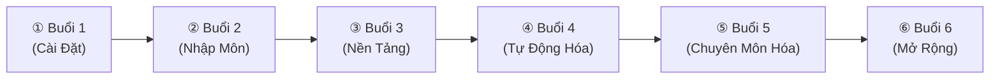

# Claude CoWork Agent Mastery — Giới Thiệu Khóa Học

## 📑 Mục lục
- [[#🎯 Mục tiêu khóa học]]
- [[#👥 Đối tượng tham gia]]
- [[#🛠️ Yêu cầu chuẩn bị]]
- [[#🗺️ Roadmap 6 buổi học]]
- [[#📅 Lịch học chi tiết]]
- [[#📊 Bảng tổng quan khóa học]]
- [[#📖 Hướng dẫn sử dụng tài liệu trong Obsidian]]
- [[#🏆 Cam kết đầu ra]]
- [[#🔗 Liên Kết]]

## 🎯 Mục tiêu khóa học
Chào mừng bạn đến với **Claude CoWork Agent Mastery** (Khóa K5)! Đây là chương trình đào tạo chuyên sâu được thiết kế đặc biệt nhằm giúp bạn:
- **Làm chủ CoWork**: Hiểu rõ bản chất, cơ chế hoạt động và cách tận dụng tối đa khả năng của Claude trong môi trường làm việc chuyên nghiệp.
- **Tối ưu hiệu suất**: Biến AI thành một trợ lý đắc lực, xử lý các tác vụ lặp đi lặp lại một cách nhanh chóng và chính xác.
- **Tăng tốc công việc**: Giảm thiểu thời gian hoàn thành dự án, nâng cao chất lượng đầu ra nhờ sự hỗ trợ của trí tuệ nhân tạo.

Khóa học không chỉ dừng lại ở lý thuyết mà tập trung mạnh mẽ vào thực hành thực tế, giúp bạn có thể áp dụng ngay vào công việc hằng ngày của mình.

> [!IMPORTANT]
> Mục tiêu cốt lõi: Thay đổi tư duy làm việc từ "Làm việc chăm chỉ" (Working hard) sang "Làm việc thông minh cùng AI" (Working smart with AI).

## 👥 Đối tượng tham gia
Khóa học này được thiết kế theo hướng tiếp cận "Zero to Hero" - từ con số 0 đến làm chủ công nghệ, phù hợp với:

1. **Người mới bắt đầu (Beginners)**: Chưa từng tiếp xúc với AI hoặc chỉ mới nghe nói đến nhưng chưa biết cách ứng dụng hiệu quả.
2. **Nhân viên văn phòng (Office Workers)**: Những người thường xuyên phải xử lý văn bản, email, báo cáo, dữ liệu và muốn tự động hóa công việc.
3. **Người làm tự do (Freelancers)**: Content creator, designer, marketer muốn tăng năng suất để nhận thêm nhiều dự án mà không bị quá tải.
4. **Bất kỳ ai muốn tự động hóa công việc**: Dành cho những ai mong muốn tối ưu hóa quy trình làm việc cá nhân để tiết kiệm thời gian.

## 🛠️ Yêu cầu chuẩn bị
Để có thể theo kịp nội dung khóa học và thực hành hiệu quả, bạn cần chuẩn bị:

- **Thiết bị**: Máy tính cá nhân (Laptop hoặc PC) có kết nối internet ổn định. (Không khuyến khích học hoàn toàn trên điện thoại vì thao tác sẽ chậm hơn).
- **Tài khoản Anthropic**: Đây là tài khoản để sử dụng Claude. Đừng lo lắng nếu bạn chưa có, chúng ta sẽ được hướng dẫn chi tiết cách tạo ở Buổi 1.
- **Kiến thức**: Chỉ cần kỹ năng tin học văn phòng cơ bản (biết sử dụng trình duyệt web, copy, paste).
- **Phần mềm**: Cài đặt sẵn **Obsidian** (Phần mềm ghi chú) để đọc và quản lý tài liệu khóa học này một cách tốt nhất.

> [!TIP]
> Hãy tạo một thư mục riêng trên máy tính có tên `Claude_CoWork_Mastery` để lưu trữ tất cả tài liệu và bài tập thực hành trong suốt khóa học.

## 🗺️ Roadmap 6 buổi học
Hành trình của chúng ta sẽ trải qua 6 chặng đường, được thiết kế logic từ cơ bản đến nâng cao.

Lộ trình này đảm bảo bạn sẽ xây dựng được một nền móng vững chắc trước khi bước vào các kỹ thuật phức tạp.

## 📅 Lịch học chi tiết
Thời gian học được phân bổ hợp lý để bạn có đủ thời gian tiếp thu lý thuyết và thực hành.

- **Buổi 1**: Học ngay sau khi đăng ký thành công (Video/Tài liệu tự học).
- **Buổi 2**: Sáng ngày 26/7 (8:30 - 11:30)
- **Buổi 3**: Chiều ngày 26/7 (13:30 - 16:30)
- **Buổi 4**: Tối ngày 30/7 (19:30 - 22:00)
- **Buổi 5**: Sáng ngày 02/8 (8:30 - 11:30)
- **Buổi 6**: Chiều ngày 02/8 (13:30 - 16:30)

> [!WARNING]
> Hãy đánh dấu (Bookmark) lịch này vào Google Calendar của bạn để không bỏ lỡ bất kỳ buổi học nào nhé!

## 📊 Bảng tổng quan khóa học

Dưới đây là chi tiết nội dung của từng buổi học để bạn dễ hình dung:

| # | Buổi | Chủ đề | Kỹ năng đạt được | Độ khó |
|---|------|--------|------------------|--------|
| 1 | Buổi 1 | Cài đặt CoWork Claude | Khởi tạo tài khoản, thiết lập môi trường | ⭐ |
| 2 | Buổi 2 | Nhập môn tư duy AI | Hiểu cách AI suy nghĩ, viết prompt cơ bản | ⭐ |
| 3 | Buổi 3 | Nền tảng Prompt Engineering | Cấu trúc prompt chuẩn, kỹ thuật Few-shot | ⭐⭐ |
| 4 | Buổi 4 | Tự động hóa quy trình | Xử lý hàng loạt, kết nối API cơ bản | ⭐⭐ |
| 5 | Buổi 5 | Chuyên môn hóa Agent | Tạo Agent chuyên biệt cho từng tác vụ | ⭐⭐⭐ |
| 6 | Buổi 6 | Mở rộng & Tích hợp | Tích hợp vào quy trình thực tế, bảo mật | ⭐⭐⭐ |

## 📖 Hướng dẫn sử dụng tài liệu trong Obsidian

Toàn bộ tài liệu khóa học được viết bằng Markdown và tối ưu hóa cho **Obsidian** [^1]. Để có trải nghiệm tốt nhất:

1. **Điều hướng (Navigate)**: Sử dụng các thẻ (Tags) và cấu trúc thư mục ở cột bên trái để di chuyển giữa các bài học.
2. **Liên kết (Wiki-link)**: Các đoạn chữ có dấu ngoặc vuông đôi như `[[Tên bài học]]` là các liên kết. Bạn có thể click vào để nhảy trực tiếp sang bài học liên quan.
3. **Hộp thông báo (Callout boxes)**: Chú ý các hộp màu sắc trong tài liệu.
   - Màu xanh (NOTE, TIP): Thông tin thêm, mẹo hay.
   - Màu vàng/đỏ (WARNING, IMPORTANT): Cảnh báo, lỗi thường gặp hoặc kiến thức cực kỳ quan trọng.
4. **Mã nguồn (Code blocks)**: Có nút "Copy" ở góc trên bên phải các khối code để bạn dễ dàng sao chép và sử dụng.

> [!NOTE]
> Bạn có thể bấm `Ctrl + O` (Windows) hoặc `Cmd + O` (Mac) trong Obsidian để mở bảng tìm kiếm nhanh bài học.

## 🏆 Cam kết đầu ra

Sau khi hoàn thành 6 buổi học và thực hiện đầy đủ các bài tập thực hành, chúng tôi cam kết bạn sẽ:
- Nắm vững 100% cách sử dụng giao diện và tính năng của Claude CoWork.
- Tự tay xây dựng được ít nhất 3 trợ lý AI (Agent) phục vụ trực tiếp cho công việc hiện tại của bạn.
- Tiết kiệm ít nhất 30% thời gian xử lý các công việc lặp đi lặp lại hàng ngày (như viết email, làm báo cáo, tóm tắt tài liệu).
- Có khả năng tự thiết kế các câu lệnh (Prompt) chuẩn xác, khiến AI hiểu và trả về kết quả đúng ý ngay từ lần đầu tiên.

Hãy chuẩn bị tinh thần sẵn sàng để bước vào kỷ nguyên của trí tuệ nhân tạo!

---
## 🔗 Liên Kết
- **Buổi tiếp theo:** [[01-cai-dat-cowork-claude]]
- **Tài nguyên hỗ trợ:** Group Zalo Lớp K5

   

---
**Footnotes**
[^1]: **Obsidian**: Là một ứng dụng ghi chú mạnh mẽ dựa trên Markdown, giúp tạo ra một mạng lưới kiến thức cá nhân (Personal Knowledge Management).
