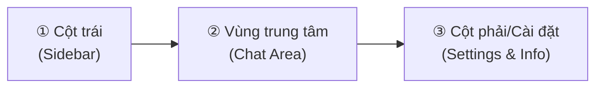

# Buổi 1 — Cài Đặt CoWork Claude

## 📑 Mục lục
- [[#🎯 Mục tiêu buổi học]]
- [[#Phần 1 — Claude CoWork là gì?]]
- [[#Phần 2 — Tạo tài khoản Anthropic]]
- [[#Phần 3 — Đăng nhập & Làm quen giao diện]]
- [[#Phần 4 — Nâng cấp tài khoản Pro]]
- [[#Phần 5 — Thiết lập ban đầu]]
- [[#Phần 6 — Sử dụng cơ bản]]
- [[#✏️ Bài Tập Thực Hành]]
- [[#📝 Tóm Tắt Buổi Học]]
- [[#🔗 Liên Kết]]

## 🎯 Mục tiêu buổi học
Kết thúc buổi học này, bạn sẽ có khả năng:
- Hiểu rõ sự khác biệt giữa Claude thông thường và môi trường CoWork.
- Tự tay tạo, xác thực và bảo mật tài khoản Anthropic.
- Làm quen và thao tác mượt mà trên giao diện người dùng (UI) của hệ thống.
- Biết cách cấu hình các thiết lập cá nhân hóa để AI phục vụ đúng nhu cầu.
- Thực hiện thành công các tương tác đầu tiên: hội thoại, tải file, và viết câu lệnh cơ bản.

---

## Phần 1 — Claude CoWork là gì?

### Tại sao cần biết điều này?
Trước khi bắt đầu sử dụng bất kỳ công cụ nào, việc hiểu rõ bản chất của nó sẽ giúp bạn biết được "mình đang cầm trong tay vũ khí gì" và "nó có thể giải quyết được vấn đề gì".

### Lý thuyết
**Claude** là một mô hình ngôn ngữ lớn (Large Language Model - LLM) được phát triển bởi công ty **Anthropic**. Giống như ChatGPT, Claude có thể trò chuyện, viết mã, phân tích dữ liệu và tư duy logic một cách xuất sắc.

Tuy nhiên, **Claude CoWork** (hay môi trường làm việc cộng tác với Claude) không chỉ là một giao diện chat (trò chuyện) đơn thuần. Nó được thiết kế như một **Workspace** (Không gian làm việc) chuyên nghiệp, nơi AI không chỉ trả lời câu hỏi mà còn đóng vai trò như một **Agent** (Trợ lý tự trị) có khả năng:
- Nhớ ngữ cảnh dự án trong thời gian dài.
- Xử lý một lượng lớn tài liệu phức tạp.
- Kết nối với các quy trình công việc cá nhân.

### Sự khác biệt cơ bản

Dưới đây là bảng so sánh giúp bạn dễ hình dung:

| # | Tiêu chí | Claude.ai thông thường | Claude CoWork / API Agent |
|---|----------|------------------------|---------------------------|
| 1 | **Mục đích** | Chat nhanh, hỏi đáp tức thời | Xử lý dự án, công việc dài hạn |
| 2 | **Lưu trữ** | Rời rạc theo từng đoạn chat | Hệ thống hóa theo Dự án/Knowledge base |
| 3 | **Độ sâu** | Quên dần ngữ cảnh cũ | Nhớ chính xác cấu trúc tài liệu lớn |
| 4 | **Tự động hóa** | Gần như không có | Có thể thiết lập quy trình (Workflow) |
| 5 | **Phù hợp cho** | Học sinh, sinh viên, người dùng phổ thông | Chuyên gia, doanh nghiệp, freelancer |

> [!IMPORTANT]  
> Trong khóa học này, chúng ta sẽ tập trung vào tư duy sử dụng Claude như một "Đồng nghiệp" (Co-worker) thực thụ, chứ không chỉ là một cỗ máy tìm kiếm.

---

## Phần 2 — Tạo tài khoản Anthropic

### Tại sao cần biết điều này?
Để sử dụng sức mạnh của Claude, bạn bắt buộc phải có "chìa khóa" vào hệ thống. Việc tạo tài khoản đúng cách giúp tránh các lỗi bị khóa tài khoản đáng tiếc.

### Các bước thực hiện

Để đăng ký, bạn cần chuẩn bị một địa chỉ Email (Khuyên dùng Gmail) và một số điện thoại để nhận mã xác thực (SMS).

1. Truy cập vào trang chủ: `https://claude.ai`
2. Tại màn hình chính, chọn **Continue with Google** (Khuyên dùng cho nhanh) hoặc nhập email của bạn vào ô trống.
3. Nếu dùng Email, hệ thống sẽ gửi một mã OTP (Mã dùng một lần) gồm 6 chữ số vào hòm thư. Bạn lấy mã đó nhập vào web.
4. **Xác thực số điện thoại (Phone Verification)**: 
   - Chọn quốc gia `Vietnam (+84)`.
   - Nhập số điện thoại của bạn (bỏ số 0 ở đầu).
   - Nhập mã SMS hệ thống gửi về.
5. Cập nhật tên hiển thị của bạn (Ví dụ: `Nguyen Van A`) và đồng ý với các điều khoản sử dụng.

> [!WARNING]  
> Hiện tại Anthropic có thể chặn đăng ký ở một số khu vực. Nếu bạn gặp lỗi không nhận được SMS hoặc bị báo "Unavailable in your region", bạn có thể cần dùng VPN (Mạng riêng ảo) để chuyển vùng sang US/UK trong lúc đăng ký.

### Ví dụ minh họa

Khi bạn click vào trang chủ, bạn sẽ thấy giao diện tối giản với một dòng chữ "Good morning". Việc của bạn chỉ là tìm ô `Enter email address` ở giữa màn hình. Rất trực quan!

---

## Phần 3 — Đăng nhập & Làm quen giao diện

### Tại sao cần biết điều này?
Biết rõ các nút bấm nằm ở đâu giúp bạn tiết kiệm hàng chục phút loay hoay mỗi ngày, từ đó thao tác nhanh như một chuyên gia.

### Sơ đồ giao diện cơ bản

Giao diện (UI) của Claude được chia thành 3 phần chính, rất giống với các ứng dụng nhắn tin hiện đại:



### Chi tiết các thành phần

1. **Sidebar (Cột bên trái)**:
   - **Start new chat** (Nút tạo cuộc trò chuyện mới): Bấm vào đây mỗi khi bạn muốn bàn về một chủ đề hoàn toàn mới.
   - **Recent chats** (Lịch sử trò chuyện): Lưu lại toàn bộ các cuộc nói chuyện cũ để bạn tiếp tục bất cứ lúc nào.
2. **Chat Area (Vùng trò chuyện trung tâm)**:
   - Đây là sân khấu chính. Nơi chứa nội dung Claude trả lời.
   - Phía dưới cùng là **Input box** (Khung nhập liệu): Nơi bạn gõ câu lệnh (Prompt).
   - Nút cái kẹp giấy 📎: Dùng để tải lên tệp tin (Upload file).
3. **Settings (Cài đặt)**:
   - Nằm ở góc dưới cùng bên trái (biểu tượng Avatar của bạn).
   - Chứa các tùy chọn về giao diện (Sáng/Tối), nâng cấp tài khoản, và quản lý profile.

> [!TIP]  
> **Phím tắt thần thánh**: Thay vì dùng chuột bấm nút "Gửi", hãy sử dụng phím `Enter` để gửi tin nhắn. Nếu bạn muốn xuống dòng trong khung nhập liệu mà không gửi đi, hãy nhấn `Shift + Enter`.

---

## Phần 4 — Nâng cấp tài khoản Pro

### Tại sao cần biết điều này?
Tài khoản miễn phí (Free) đủ để học, nhưng nếu bạn dùng cho công việc thực tế, bạn sẽ nhanh chóng chạm giới hạn (Limit). Việc hiểu rõ các gói cước giúp bạn đầu tư đúng chỗ.

### So sánh các gói cước

| # | Gói cước | Mức giá | Giới hạn sử dụng | Tính năng nổi bật |
|---|----------|---------|------------------|-------------------|
| 1 | **Free** | $0 | Ít (Khoảng 20-30 tin/ngày) | Dùng bản Sonnet 3.5 tiêu chuẩn |
| 2 | **Pro** | $20/tháng | Gấp 5 lần bản Free | Ưu tiên server lúc cao điểm, dùng Opus |
| 3 | **Team** | $30/user | Cao hơn bản Pro | Chia sẻ không gian làm việc nhóm |

### Hướng dẫn thanh toán an toàn

Nếu quyết định nâng cấp lên gói Pro (Claude Pro), bạn cần có thẻ thanh toán quốc tế (Visa/Mastercard).

1. Bấm vào Avatar (Góc dưới trái) -> Chọn **Upgrade to Pro**.
2. Nhập thông tin thẻ (Số thẻ, ngày hết hạn, mã CVC).
3. Hệ thống sẽ tự động trừ $20 mỗi tháng.

> [!NOTE]  
> **Mẹo tiết kiệm**: Nếu bạn sợ bị trừ tiền tự động các tháng sau khi không có nhu cầu dùng nữa, hãy dùng **Thẻ ảo (Virtual Card)** của các ngân hàng nội địa hoặc ví điện tử, nạp đúng số tiền cần thiết để thanh toán. Bạn cũng có thể Cancel Subscription (Hủy đăng ký) ngay sau khi thanh toán thành công, tài khoản Pro vẫn giữ nguyên hạn dùng 30 ngày.

---

## Phần 5 — Thiết lập ban đầu

### Tại sao cần biết điều này?
Claude là một mô hình toàn cầu. Nếu không thiết lập, đôi khi AI sẽ trả lời bằng tiếng Anh hoặc trả lời quá dài dòng không cần thiết.

### Custom Instructions (Chỉ thị tùy chỉnh)

Đây là một tính năng cực mạnh. Nó giống như việc bạn nói với trợ lý của mình: "Từ nay về sau, hãy luôn nhớ các quy tắc này khi làm việc với tôi".

**Ví dụ về Custom Instruction cho người Việt:**
Bạn có thể cấu hình (nếu dùng qua API hoặc các giao diện hỗ trợ System Prompt) đoạn mã sau:

```markdown
Bạn là một trợ lý ảo chuyên nghiệp. Hãy tuân thủ các quy tắc sau:
1. LUÔN LUÔN trả lời bằng Tiếng Việt, trừ khi tôi yêu cầu ngôn ngữ khác.
2. Trả lời ngắn gọn, đi thẳng vào trọng tâm, không cần chào hỏi rườm rà.
3. Nếu phải giải thích thuật ngữ chuyên ngành tiếng Anh, hãy giữ nguyên từ gốc và đặt giải thích tiếng Việt trong ngoặc đơn.
4. Khi viết code, luôn thêm chú thích (comment) rõ ràng.
```

Việc cấu hình này giúp bạn không phải gõ đi gõ lại dòng chữ "Hãy trả lời bằng tiếng Việt" trong mỗi cuộc trò chuyện mới.

---

## Phần 6 — Sử dụng cơ bản

### Tại sao cần biết điều này?
Thực hành là cách nhanh nhất để làm quen. Bạn cần trải nghiệm các tính năng cốt lõi để thấy được tốc độ và sự mượt mà của hệ thống.

### 1. Tạo conversation đầu tiên (Hội thoại)
- Bấm **Start new chat**.
- Gõ vào khung nhập: `Chào Claude, hãy viết cho tôi 3 lợi ích của việc học lập trình bằng ngôn ngữ dễ hiểu nhất.`
- Nhấn `Enter` và quan sát tốc độ sinh văn bản.

### 2. Upload file (Tải tệp tin lên)
Claude rất mạnh trong việc đọc tài liệu. Hỗ trợ PDF, file Word, Text, Code (Python, JS...), hình ảnh (JPG, PNG).

- Bấm vào biểu tượng 📎 (Kẹp giấy).
- Chọn 1 file PDF bất kỳ từ máy tính của bạn (Ví dụ: Một bản hợp đồng, một bài báo khoa học).
- Kèm theo câu lệnh: `Hãy tóm tắt 3 ý chính quan trọng nhất trong tài liệu này.`

### 3. Ví dụ Prompt mẫu (Câu lệnh) cho các công việc

**Cho Dịch thuật:**
```text
Hãy dịch đoạn văn bản tiếng Anh sau sang tiếng Việt. 
Yêu cầu: Dịch thuật ngữ tự nhiên, giọng văn trang trọng phù hợp với email công sở.
[Dán đoạn văn bản vào đây]
```

**Cho Tóm tắt:**
```text
Hãy đọc bài báo này và tạo ra một bản tóm tắt dưới dạng 5 gạch đầu dòng ngắn gọn. Tập trung vào các con số và dữ liệu thống kê.
```

**Cho Lên ý tưởng (Brainstorming):**
```text
Tôi đang muốn mở một quán cà phê mang phong cách hoài cổ (retro) ở Hà Nội. Hãy gợi ý cho tôi 10 cái tên độc đáo, dễ nhớ và có ý nghĩa.
```

---

## ✏️ Bài Tập Thực Hành

Hãy dành ít nhất 30 phút để hoàn thành các bài tập dưới đây trước khi bước sang Buổi 2. Việc tự tay làm sẽ giúp "cơ bắp trí nhớ" của bạn hoạt động.

### ⭐ Bài Tập 1: Điểm danh
**Yêu cầu:** Tạo tài khoản thành công, đăng nhập vào hệ thống và chụp màn hình giao diện chính có chứa Avatar của bạn.
**Mục đích:** Đảm bảo bạn đã vượt qua rào cản kỹ thuật đầu tiên.

<details>
<summary>💡 Xem gợi ý đáp án</summary>
Truy cập claude.ai, dùng tài khoản Google để đăng nhập nhanh nhất. Nếu lỗi khu vực, hãy nhớ dùng VPN (như tiện ích 1.1.1.1 hoặc Hola VPN).
</details>

### ⭐ Bài Tập 2: Lời chào
**Yêu cầu:** Tạo một đoạn chat mới. Hỏi Claude câu sau: "Giải thích Claude CoWork là gì cho một học sinh lớp 5 hiểu."
**Mục đích:** Luyện tập thao tác tạo hội thoại mới và thấy được khả năng biến đổi giọng văn (Tone of voice) của AI.

<details>
<summary>💡 Xem gợi ý đáp án</summary>
Bấm "Start new chat" ở cột trái. Nhập nguyên văn câu hỏi vào ô. Chú ý cách AI sử dụng từ ngữ đơn giản, gần gũi như "trợ lý tàng hình", "người bạn siêu thông minh" thay vì dùng từ chuyên ngành.
</details>

### ⭐⭐ Bài Tập 3: Trợ lý đọc sách
**Yêu cầu:** 
1. Tải lên (Upload) một file PDF tài liệu bất kỳ (Khuyến nghị file dài khoảng 5-10 trang).
2. Gõ Prompt: "Hãy đóng vai một chuyên gia tóm tắt sách. Chỉ ra 3 điểm cốt lõi nhất của tài liệu này và ứng dụng thực tiễn của nó."
**Mục đích:** Trải nghiệm tốc độ đọc dữ liệu cực nhanh của Claude so với con người.

<details>
<summary>💡 Xem gợi ý đáp án</summary>
Dùng nút hình cái kẹp giấy 📎. Đợi file tải lên hoàn tất (hiện tên file màu xanh) rồi mới bấm `Enter`. Nếu file quá lớn (quá giới hạn Token), hệ thống sẽ cảnh báo đỏ.
</details>

### ⭐⭐ Bài Tập 4: Cá nhân hóa
**Yêu cầu:** Viết một đoạn Custom Instruction (Chỉ thị hệ thống/Giới thiệu bản thân) khoảng 3-4 dòng, mô tả công việc hiện tại của bạn để lưu lại dùng dần.
**Mục đích:** Xây dựng bối cảnh (Context) cá nhân.

<details>
<summary>💡 Xem gợi ý đáp án</summary>
Ví dụ đáp án mẫu bạn có thể soạn ra Notepad để sau này dùng:
"Tôi là một Content Creator làm việc trong mảng giáo dục. Khách hàng của tôi là sinh viên đại học. Khi viết bài cho tôi, hãy luôn dùng giọng văn trẻ trung, gen Z, dùng nhiều emoji và chia đoạn ngắn dễ đọc trên điện thoại."
</details>

---

## 📝 Tóm Tắt Buổi Học

Sau buổi học này, hãy ghi nhớ 3 điểm cốt lõi (Key takeaways):
1. **Claude CoWork** là một môi trường làm việc thông minh, nơi AI đóng vai trò như một người đồng nghiệp xử lý dự án.
2. **Giao diện làm việc** rất trực quan: Cột trái quản lý lịch sử, vùng giữa là không gian tương tác, cột phải/góc trái là cài đặt.
3. **Thao tác cơ bản** bao gồm: Chat bình thường, đính kèm file (PDF, code, ảnh) và sử dụng các câu lệnh (Prompt) rõ ràng để điều khiển AI.

---
## 🔗 Liên Kết
- **Buổi trước:** [[00-gioi-thieu-khoa-hoc]]
- **Buổi tiếp theo:** [[02-nhap-mon-cowork-claude]]
- **Tra cứu thuật ngữ:** Dưới cùng trang

<br><br>

---
**Bảng Tra Cứu Thuật Ngữ (Glossary)**

| Thuật ngữ (Term) | Giải thích (Tiếng Việt) |
|------------------|-------------------------|
| **LLM** (Large Language Model) | Mô hình ngôn ngữ lớn, công nghệ lõi tạo nên các AI như Claude hay ChatGPT. |
| **Prompt** | Câu lệnh, lời nhắc hoặc yêu cầu bạn gõ vào để điều khiển AI. |
| **Context** | Ngữ cảnh. Là những thông tin, dữ liệu bạn cung cấp để AI hiểu tình huống. |
| **Agent** | Trợ lý tự trị, có khả năng tự suy luận và giải quyết từng phần của một công việc phức tạp. |
| **Token** | Đơn vị tính khối lượng từ vựng của AI. Tương đương với các âm tiết hoặc chữ cái. |
| **Workspace** | Không gian làm việc, nơi chứa các tài nguyên, dự án và thiết lập của bạn. |
