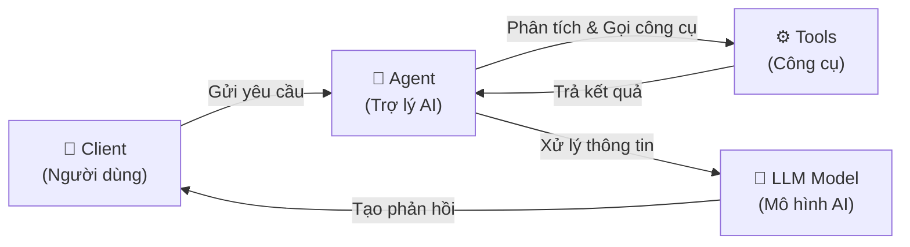
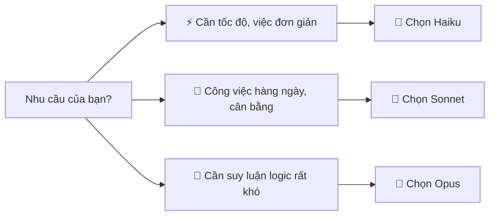

# Buổi 2 — Nhập Môn CoWork Claude

## 📑 Mục lục
- [[#🎯 Mục tiêu buổi học]]
- [[#Phần 1 — Kiến thức nền tảng CoWork]]
- [[#Phần 2 — Các Agent và khả năng LLM Model]]
- [[#Phần 3 — CoWork trong văn phòng Word]]
- [[#Phần 4 — CoWork trong văn phòng Excel]]
- [[#Phần 5 — CoWork trong văn phòng PowerPoint]]
- [[#Phần 6 — Connector & Plugin Kết nối dữ liệu]]
- [[#✏️ Bài Tập Thực Hành]]
- [[#📝 Tóm Tắt Buổi Học]]
- [[#🔗 Liên Kết]]

## 🎯 Mục tiêu buổi học
- Hiểu rõ cách thức hoạt động cơ bản của hệ thống CoWork và các thuật ngữ quan trọng.
- Phân biệt được sự khác nhau giữa các mô hình AI của Claude và chọn đúng công cụ cho từng tình huống.
- Nắm vững cách ứng dụng CoWork vào các công việc văn phòng thường ngày (Word, Excel, PowerPoint).
- Biết cách thiết lập kết nối (Connector) để tự động hóa trích xuất dữ liệu từ các nền tảng bên ngoài.

---

## Phần 1 — Kiến thức nền tảng CoWork

### Tại sao cần biết điều này?
Khi bạn hiểu hệ thống bên dưới hoạt động thế nào, bạn sẽ biết tại sao AI đôi khi trả lời chậm, tại sao nó quên những gì bạn nói ở đầu cuộc hội thoại, và cách đưa ra yêu cầu để AI làm việc hiệu quả nhất.

### 1. Kiến trúc hệ thống CoWork
CoWork không chỉ là một khung chat đơn giản. Nó là một hệ thống phối hợp nhịp nhàng giữa 3 thành phần chính: **Client** (Ứng dụng người dùng), **Agent** (Trợ lý AI), và **LLM Model** (Mô hình ngôn ngữ lớn).

- **Client** (Ứng dụng người dùng): Đây là giao diện bạn đang nhìn thấy, nơi bạn gõ chữ, click nút, và tải file lên.
- **Agent** (Trợ lý AI): Đóng vai trò như một người quản lý. Khi bạn yêu cầu điều gì đó, Agent sẽ xem xét liệu nó có cần dùng các công cụ khác (như đọc file, tìm kiếm web) trước khi gửi thông tin cho mô hình AI hay không.
- **LLM Model** (Mô hình ngôn ngữ lớn): "Bộ não" thực sự, chịu trách nhiệm đọc hiểu yêu cầu của bạn và tạo ra câu trả lời.



### 2. LLM Model, Token và Context Window là gì?

> [!NOTE]
> Đây là 3 khái niệm cốt lõi nhất để bạn hiểu giới hạn của AI.

- **LLM Model** (Mô hình ngôn ngữ lớn): Một chương trình máy tính khổng lồ đã "đọc" hàng tỷ trang tài liệu để học cách con người sử dụng ngôn ngữ. Nó dự đoán từ tiếp theo để tạo ra câu hoàn chỉnh.
- **Token** (Đơn vị tính toán): AI không đọc từng chữ như chúng ta, nó cắt chữ thành các mảnh nhỏ gọi là Token. Trung bình 1 Token tương đương 3/4 của một từ tiếng Anh (hoặc khoảng 1-2 ký tự tiếng Việt do dấu câu phức tạp hơn).
- **Context Window** (Cửa sổ ngữ cảnh): Giống như "trí nhớ ngắn hạn" của AI. Nếu Context Window là 100.000 tokens, tức là AI có thể nhớ khoảng 75.000 từ trong cuộc trò chuyện hiện tại. Nếu bạn chat vượt quá số này, nó sẽ bắt đầu "quên" những gì bạn nói ở phần đầu.

### Ví dụ thực tế
Tưởng tượng bạn thuê một người trợ lý mới (LLM Model). Người trợ lý này rất thông minh nhưng chỉ có thể nhớ tối đa 1 cuốn sách 100 trang cùng một lúc (Context Window). Bạn đưa cho trợ lý 1 trang giấy (Token) để đọc và yêu cầu tóm tắt. Trợ lý (Agent) sẽ lấy trang giấy từ bạn (Client), đưa vào đầu để phân tích (LLM Model), và trả lại cho bạn bản tóm tắt.

### Bài tập nhỏ
Bạn tải lên một file tài liệu dài 500 trang (khoảng 300.000 tokens) và yêu cầu AI tóm tắt nội dung trang 1. Biết rằng mô hình AI bạn dùng có Context Window là 200.000 tokens. Điều gì sẽ xảy ra?
<details>
<summary>💡 Xem gợi ý đáp án</summary>
AI sẽ không thể xử lý toàn bộ file vì file này (300.000 tokens) đã vượt quá "trí nhớ ngắn hạn" (Context Window - 200.000 tokens) của nó. Nó có thể sẽ báo lỗi độ dài hoặc chỉ đọc được phần sau của tài liệu và quên phần đầu.
</details>

---

## Phần 2 — Các Agent và khả năng LLM Model

### Tại sao cần biết điều này?
Anthropic (công ty tạo ra Claude) cung cấp nhiều phiên bản AI khác nhau. Việc chọn đúng phiên bản giống như việc bạn chọn phương tiện di chuyển: đi chợ thì dùng xe máy, chở hàng thì dùng xe tải. Chọn sai sẽ làm bạn vừa tốn tiền vừa mất thời gian.

### 1. So sánh các mô hình Claude hiện tại

| # | Mô hình | Tốc độ | Khả năng suy luận | Giá thành | Use Case (Trường hợp sử dụng) |
|---|---|---|---|---|---|
| 1 | **Claude 3 Haiku** | Rất nhanh | Cơ bản | Rẻ nhất | Tóm tắt email nhanh, phân loại dữ liệu, chat đơn giản. |
| 2 | **Claude 3.5 Sonnet** | Nhanh | Rất tốt | Vừa phải | Làm việc văn phòng, lập trình, viết lách sáng tạo. Phù hợp 90% công việc hàng ngày. |
| 3 | **Claude 3 Opus** | Chậm | Xuất sắc | Rất đắt | Xử lý các bài toán logic phức tạp, chiến lược dài hạn, nghiên cứu chuyên sâu. |

> [!TIP]
> Đối với người dùng thông thường và dân văn phòng, **Claude 3.5 Sonnet** luôn là sự lựa chọn tốt nhất về độ cân bằng giữa tốc độ, trí thông minh và chi phí.

### 2. Decision Tree (Cây quyết định) khi chọn model



### 3. Ví dụ so sánh Output

Cùng 1 Prompt: "Giải thích ngắn gọn tại sao bầu trời màu xanh cho trẻ 5 tuổi."

- **Haiku**: "Bầu trời màu xanh vì ánh sáng mặt trời có nhiều màu. Khi chiếu xuống Trái Đất, màu xanh da trời bị không khí làm phân tán ra khắp nơi, nên con thấy bầu trời có màu xanh!" (Nhanh, trực diện).
- **Sonnet**: "Chào bé! Con tưởng tượng ánh sáng mặt trời giống như một hộp màu sáp có đủ bảy sắc cầu vồng nhé. Khi ánh sáng này bay đến Trái Đất, nó phải chui qua một lớp không khí (giống như một cái chăn khổng lồ). Trong lúc chui qua, màu xanh nước biển bị vấp ngã và văng tung tóe khắp nơi. Nên khi con ngước lên nhìn, con sẽ thấy màu xanh lan tỏa khắp bầu trời đấy!" (Dễ thương, dễ hiểu, có hình ảnh ví von).

### Bài tập nhỏ
Nếu bạn cần duyệt qua 1.000 phản hồi khảo sát khách hàng chỉ để gom nhóm xem ý kiến nào tích cực, ý kiến nào tiêu cực. Bạn sẽ chọn mô hình nào?
<details>
<summary>💡 Xem gợi ý đáp án</summary>
Nên chọn **Claude 3 Haiku**. Việc phân tích sắc thái đơn giản (tích cực/tiêu cực) không đòi hỏi suy luận phức tạp, trong khi số lượng dữ liệu lớn (1.000 phản hồi) sẽ cần tốc độ cao và chi phí xử lý rẻ.
</details>

---

## Phần 3 — CoWork trong văn phòng Word

### Tại sao cần biết điều này?
Việc soạn thảo các tài liệu lặp đi lặp lại như báo cáo, hợp đồng, đơn từ chiếm rất nhiều thời gian. CoWork giúp bạn tạo ra khung sườn tài liệu chuẩn chỉ trong vài giây.

### 1. Dùng CoWork tạo văn bản chuyên nghiệp
Bạn không chỉ bảo Claude "viết cho tôi cái báo cáo". Để có một văn bản Word chuyên nghiệp, bạn cần chỉ rõ định dạng, tone giọng, và các đầu mục cần thiết.

> [!IMPORTANT]
> Hãy coi AI như một thực tập sinh ngoan ngoãn. Bạn hướng dẫn càng chi tiết, thực tập sinh làm càng đúng ý. Đừng bắt AI đoán ý bạn.

### 2. Prompt Template (Mẫu câu lệnh) cơ bản
Dưới đây là một cấu trúc bạn có thể copy-paste để tạo ra bất kỳ loại tài liệu nào:

```markdown
Đóng vai là một [Vai trò của bạn, ví dụ: Chuyên viên Nhân sự]. 
Hãy soạn thảo một [Loại tài liệu, ví dụ: Thông báo nghỉ lễ] với các thông tin sau:
- Thông tin 1: [Thời gian nghỉ]
- Thông tin 2: [Yêu cầu trực ban]
- Thông tin 3: [Lời chúc]

Yêu cầu định dạng:
- Tone giọng: [Ví dụ: Chuyên nghiệp, trang trọng]
- Trình bày rõ ràng bằng các Heading, bullet points.
- Xuất ra dưới dạng văn bản có thể dễ dàng copy vào MS Word.
```

### 3. Ví dụ: Tạo báo cáo tháng cho phòng Marketing

**Prompt thực tế:**
"Đóng vai là Trưởng phòng Marketing. Hãy soạn khung một Báo cáo tổng kết tháng 7 với các số liệu sau:
- Chi tiêu Ads: 50 triệu VNĐ, mang về 1000 khách hàng tiềm năng (Leads).
- Sự kiện Offline: tổ chức thành công, có 200 người tham gia.
- Vấn đề: Website load hơi chậm vào cuối tháng.
Yêu cầu trình bày chuyên nghiệp, chia thành các phần: Tổng quan, Chi tiết hoạt động, Khó khăn, và Đề xuất tháng 8."

**Kết quả AI trả về:**
AI sẽ viết ra một văn bản mạch lạc, sắp xếp tiêu đề rõ ràng, biến các gạch đầu dòng khô khan của bạn thành những đoạn văn báo cáo chỉn chu. Bạn chỉ việc copy dán vào Word.

### Bài tập nhỏ
Sử dụng Prompt Template ở trên, hãy điền thông tin để tạo một "Thông báo thay đổi giờ làm việc mùa đông" cho công ty.
<details>
<summary>💡 Xem gợi ý đáp án</summary>
Đóng vai là Trưởng phòng Hành chính. 
Hãy soạn thảo một Thông báo thay đổi giờ làm việc mùa đông với các thông tin sau:
- Thông tin 1: Giờ làm việc mới từ 8h30 đến 17h30 (thay vì 8h00 - 17h00).
- Thông tin 2: Áp dụng từ ngày 01/11.
- Thông tin 3: Yêu cầu nhân sự đi làm đúng giờ, đảm bảo tiến độ.

Yêu cầu định dạng:
- Tone giọng: Nghiêm túc, chuyên nghiệp.
- Trình bày rõ ràng bằng các Heading, bullet points.
</details>

---

## Phần 4 — CoWork trong văn phòng Excel

### Tại sao cần biết điều này?
Bạn không cần phải nhớ hàng ngàn hàm Excel phức tạp. CoWork có thể giúp bạn viết công thức, hoặc thậm chí phân tích luôn file dữ liệu nếu bạn cung cấp cho nó.

### 1. Phân tích dữ liệu Excel với CoWork
Với Claude, bạn có thể tải thẳng một file `.csv` hoặc `.xlsx` (kích thước vừa phải) lên khung chat và yêu cầu nó "đọc" dữ liệu bên trong.

### 2. Prompt Template xử lý Excel

- **Hỏi công thức:**
  "Tôi có bảng Excel với Cột A là Ngày tháng, Cột B là Doanh thu. Hãy cho tôi công thức Excel để tính tổng doanh thu chỉ trong tháng 7."

- **Yêu cầu phân tích:**
  "Tôi đã đính kèm file `doanh_thu.csv`. Hãy phân tích file này và cho tôi biết:
  1. Sản phẩm nào bán chạy nhất?
  2. Xu hướng doanh thu qua các tháng?
  3. Đưa ra 3 nhận xét quan trọng từ dữ liệu này."

> [!WARNING]
> Không tải lên dữ liệu tuyệt mật của công ty (như mật khẩu, thông tin thẻ tín dụng, dữ liệu định danh cá nhân) lên AI công cộng nếu không có các biện pháp mã hóa an toàn.

### 3. Ví dụ: Tạo công thức phức tạp
Giả sử bạn cần tách Tên từ một chuỗi "Họ và Tên".
Thay vì Google "cách tách tên excel", bạn hỏi CoWork:
"Cột A của tôi chứa 'Họ và Tên' (Ví dụ: Nguyễn Văn A). Hãy cho tôi công thức để lấy phần Tên (A) sang cột B."
Claude sẽ trả về cho bạn công thức cụ thể kèm theo hướng dẫn cách dùng (thường kết hợp hàm `RIGHT`, `LEN`, `FIND`).

---

## Phần 5 — CoWork trong văn phòng PowerPoint

### Tại sao cần biết điều này?
Tạo slide thuyết trình thường mất thời gian ở khâu lên cấu trúc nội dung. CoWork giúp bạn dàn ý chi tiết cho từng slide, giúp bạn tiết kiệm 80% thời gian chuẩn bị nội dung.

### 1. Tạo slide chuyên nghiệp với CoWork
CoWork không vẽ trực tiếp file `.pptx` cho bạn, nhưng nó sẽ viết ra nội dung cực kỳ chi tiết cho từng trang slide một cách có hệ thống.

### 2. Prompt Template tạo Presentation

```markdown
Hãy thiết kế một bản thuyết trình (Slide Deck) gồm [Số lượng] slide về chủ đề [Chủ đề].
Đối tượng khán giả là: [Ai sẽ nghe bạn thuyết trình].

Với mỗi slide, hãy cấu trúc như sau:
- **Slide số**: Tiêu đề slide
- **Nội dung chính**: Các gạch đầu dòng (bullet points) ngắn gọn để đưa lên màn hình.
- **Lời thoại của người nói (Speaker Notes)**: Kịch bản chi tiết tôi nên nói gì khi trình chiếu slide này.
- **Gợi ý hình ảnh**: Gợi ý minh họa hoặc biểu đồ phù hợp.
```

### 3. Ví dụ: Tạo slide pitch deck cho startup
"Hãy thiết kế bản thuyết trình 5 slide gọi vốn (Pitch Deck) cho ứng dụng đặt cà phê online. Khán giả là các nhà đầu tư mạo hiểm."

Kết quả từ CoWork:
- Slide 1: Vấn đề (Chờ đợi lâu khi mua cà phê buổi sáng).
- Slide 2: Giải pháp (Ứng dụng đặt trước, đến là lấy).
- Slide 3: Kích thước thị trường...
Rất chi tiết và có cả phần lời thoại cho bạn luyện tập!

---

## Phần 6 — Connector & Plugin Kết nối dữ liệu

### Tại sao cần biết điều này?
AI thông thường chỉ biết kiến thức có sẵn trên mạng. Nếu bạn muốn AI đọc tài liệu nội bộ của công ty (trong Google Drive, Notion), bạn cần dùng các "ống nối" gọi là Connector.

### 1. Connector là gì? Plugin là gì?
- **Connector** (Trình kết nối): Giống như một cái ống nước, kết nối tài khoản CoWork của bạn với các kho lưu trữ bên ngoài (Google Drive, Slack, OneDrive). Nó giúp AI có thể tự động lục tìm tài liệu nội bộ để trả lời câu hỏi của bạn.
- **Plugin** (Trình cắm thêm): Giống như việc cấp thêm "chân tay" cho AI. Thay vì chỉ nói chuyện, Plugin giúp AI có thể đặt vé máy bay, tính toán toán học, hoặc truy cập internet theo thời gian thực.

| Tiêu chí | Connector (Trình kết nối) | Plugin (Trình cắm) |
|---|---|---|
| Chức năng chính | Lấy dữ liệu từ nguồn nội bộ | Thực hiện một hành động cụ thể |
| Ví dụ | Google Drive, Notion | Máy tính bỏ túi, Expedia |
| Tính chất | Đọc dữ liệu (Read-only) | Thực thi (Execute/Action) |
| Bảo mật | Cần cấp quyền truy cập tài khoản | Phụ thuộc vào bên thứ 3 |
| Thời gian | Thiết lập 1 lần, chạy lâu dài | Dùng khi cần thiết |

### 2. Hướng dẫn setup connector đầu tiên (Google Drive)
① Đăng nhập vào CoWork Dashboard.<br>
② Truy cập mục **Integrations** (Tích hợp) > Chọn **Google Drive**.<br>
③ Click **Connect**, một cửa sổ đăng nhập Google hiện ra.<br>
④ Cấp quyền đọc file cho CoWork.<br>
⑤ Quay lại khung chat, bây giờ bạn có thể gõ `@GoogleDrive` (tùy giao diện) để yêu cầu AI tìm file.

### 3. Ví dụ: Tự động đọc file
Thay vì phải tải từng file PDF lên, sau khi nối Google Drive, bạn có thể nói:
"Hãy tìm trong Google Drive của tôi file có tên 'Quy_che_cong_ty_2026.pdf' và tóm tắt quy định nghỉ phép."
Agent sẽ dùng Connector chui vào Drive, lấy dữ liệu và trả về kết quả!

---

## ✏️ Bài Tập Thực Hành

Dưới đây là các bài tập giúp bạn ôn lại kiến thức hôm nay. Hãy mở CoWork và thực hành ngay!

### ⭐ BT1: Dùng CoWork viết 1 email chuyên nghiệp
**Đề bài:** Hãy dùng CoWork viết một email xin lỗi đối tác vì gửi trễ báo cáo dự án. Email cần được viết bằng tiếng Anh, giọng điệu chuyên nghiệp và lịch sự.
<details>
<summary>💡 Xem gợi ý đáp án</summary>
**Prompt tham khảo:** "Đóng vai là Quản lý dự án. Hãy viết một email tiếng Anh gửi cho đối tác (Mr. Smith) để xin lỗi vì gửi báo cáo dự án Q3 trễ 2 ngày. Lý do: cần thêm thời gian để đối soát số liệu cho chính xác. Giọng điệu chuyên nghiệp, lịch sự."
</details>

### ⭐⭐ BT2: Tạo 1 báo cáo Word
**Đề bài:** Yêu cầu AI tạo một khung "Báo cáo thử việc" dành cho nhân viên mới. Báo cáo cần có các Heading rõ ràng, một bảng tự đánh giá 3 tiêu chí, và phần nhận xét của quản lý.
<details>
<summary>💡 Xem gợi ý đáp án</summary>
**Prompt tham khảo:** "Hãy tạo mẫu Báo cáo thử việc cho nhân viên mới. Yêu cầu:
- Có các Heading: Thông tin cá nhân, Kết quả công việc, Mục tiêu sắp tới.
- Tạo một bảng markdown gồm 3 cột: Tiêu chí (Kỷ luật, Kỹ năng, Thái độ), Điểm tự đánh giá (1-10), và Ghi chú.
- Thêm một phần trống để Quản lý trực tiếp điền nhận xét."
</details>

### ⭐⭐ BT3: Phân tích bảng Excel mẫu
**Đề bài:** Tạo một bảng Excel giả định bằng CoWork (gồm 3 cột: Tên nhân viên, Số ngày nghỉ, Lý do). Sau đó yêu cầu AI nhận xét.
<details>
<summary>💡 Xem gợi ý đáp án</summary>
**Bước 1 - Prompt tạo dữ liệu:** "Hãy tạo cho tôi một bảng markdown giả định danh sách 5 nhân viên, bao gồm: Tên, Số ngày nghỉ phép đã dùng trong năm, Lý do nghỉ phổ biến."
**Bước 2 - Prompt phân tích:** "Từ bảng trên, ai là người nghỉ nhiều nhất? Và lý do phổ biến nhất của cả nhóm là gì?"
</details>

### ⭐⭐⭐ BT4: Tạo bộ slide 10 trang
**Đề bài:** Dùng Prompt Template trong phần 5, tạo một bộ cấu trúc slide 10 trang hướng dẫn "Cách quản lý thời gian hiệu quả cho sinh viên".
<details>
<summary>💡 Xem gợi ý đáp án</summary>
Sử dụng template đã học, thay thông tin:
"Hãy thiết kế bản thuyết trình 10 slide về chủ đề 'Cách quản lý thời gian hiệu quả'. Khán giả là Sinh viên đại học năm nhất.
Mỗi slide bao gồm: Slide số, Tiêu đề, Nội dung chính (bullet points), Lời thoại người nói, Gợi ý hình ảnh."
</details>

---

## 📝 Tóm Tắt Buổi Học
- **Kiến trúc CoWork**: Gồm Client, Agent và LLM Model.
- **Model Claude**: Nhớ kỹ 3 dòng (Haiku để nhanh-rẻ, Sonnet cho 90% việc văn phòng, Opus cho việc siêu phức tạp).
- **Ứng dụng văn phòng**: Sử dụng các Prompt Template cấu trúc rõ ràng để xử lý việc soạn thảo (Word), công thức/phân tích (Excel), và dàn ý thuyết trình (PowerPoint).
- **Connector**: Là cầu nối giúp AI truy cập vào kho tài liệu riêng tư (như Google Drive) để làm việc hiệu quả hơn mà không cần upload thủ công.

---

## 🔗 Liên Kết
- Buổi trước: [[01-cai-dat-cowork-claude]]
- Buổi tiếp theo: [[03-nen-tang-cowork-claude]]
- Thuật ngữ cần nhớ: **Token**[^1], **Context Window**[^2], **Connector**[^3], **Plugin**[^4], **LLM Model**[^5].

### 📖 Bảng Tra Cứu Thuật Ngữ (Glossary)

| # | Thuật ngữ | Giải thích ngắn gọn |
|---|---|---|
| 1 | **Token**[^1] | Đơn vị nhỏ nhất mà AI đọc (khoảng 3/4 từ tiếng Anh). |
| 2 | **Context Window**[^2] | Bộ nhớ ngắn hạn của AI trong một phiên chat. |
| 3 | **Connector**[^3] | Trình kết nối để AI đọc dữ liệu nội bộ (Google Drive...). |
| 4 | **Plugin**[^4] | Công cụ cắm thêm giúp AI thực hiện hành động thực tế. |
| 5 | **LLM Model**[^5] | Mô hình ngôn ngữ lớn, "bộ não" của AI. |

[^1]: Token: Đơn vị tính toán văn bản.
[^2]: Context Window: Cửa sổ ngữ cảnh giới hạn số lượng chữ AI có thể nhớ.
[^3]: Connector: Công cụ đồng bộ tài liệu một chiều.
[^4]: Plugin: Công cụ tương tác hai chiều.
[^5]: LLM Model: Large Language Model.
