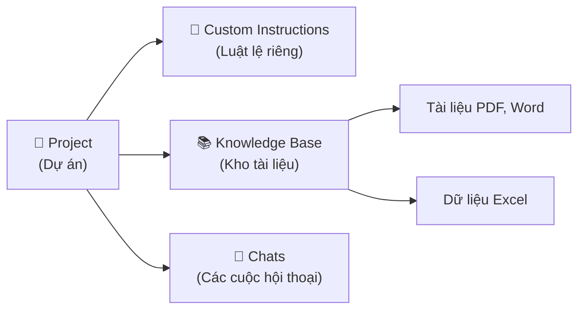

# Buổi 3 — Nền Tảng CoWork Claude

## 📑 Mục lục
- [[#🎯 Mục tiêu buổi học]]
- [[#Phần 1 — Schedule Task Tự động hóa theo lịch]]
- [[#Phần 2 — Cú pháp & Cấu hình Schedule]]
- [[#Phần 3 — Project trong CoWork]]
- [[#Phần 4 — Đặc tính Project Custom Instructions & Knowledge]]
- [[#Phần 5 — Computer Use]]
- [[#Phần 6 — Browse Use & Screen Interaction]]
- [[#✏️ Bài Tập Thực Hành]]
- [[#📝 Tóm Tắt Buổi Học]]
- [[#🔗 Liên Kết]]

## 🎯 Mục tiêu buổi học
- Hiểu và thiết lập được các tác vụ tự động hóa theo lịch (Schedule Task).
- Nắm vững khái niệm Project, cách cấu hình Custom Instructions và xây dựng Knowledge Base riêng.
- Khám phá các khả năng nâng cao của CoWork như Computer Use, Browse Use để tương tác trực tiếp với môi trường máy tính và website.

---

## Phần 1 — Schedule Task Tự động hóa theo lịch

### Tại sao cần biết điều này?
Bạn có những công việc lặp đi lặp lại mỗi ngày như: gửi email báo cáo lúc 5h chiều, kiểm tra giá đối thủ mỗi sáng. Thay vì tự làm hoặc phải nhắc AI mỗi ngày, **Schedule Task** (Tác vụ theo lịch) giúp giao việc đó cho AI tự động chạy theo mốc thời gian bạn chỉ định.

### 1. Schedule Task là gì?
Schedule Task là một tính năng cho phép bạn hẹn giờ để Agent (Trợ lý AI) tự động thực thi một Prompt (Câu lệnh) hoặc một chuỗi công việc tại một thời điểm trong tương lai, mà không cần bạn phải online hay ấn nút chạy.

### 2. Các loại Schedule
Có 3 dạng hẹn giờ chính:
- **One-time** (Một lần): Hẹn AI làm một việc gì đó một lần duy nhất vào ngày mai, tuần sau.
- **Recurring** (Định kỳ cơ bản): Hẹn AI lặp lại công việc (VD: mỗi ngày, mỗi tuần).
- **Cron-based** (Dựa trên Cron): Hệ thống hẹn giờ phức tạp nhưng cực kỳ chính xác (VD: chạy vào lúc 8h sáng và 5h chiều của ngày thứ 2 và thứ 6).

### 3. Ví dụ Use Case (Trường hợp sử dụng) thực tế
- **Báo cáo tự động**: "Vào 17h00 thứ 6 hàng tuần, hãy đọc file doanh thu trên Drive và gửi tóm tắt vào nhóm Slack."
- **Nhắc nhở**: "Vào 8h00 sáng mỗi ngày, hãy đọc lịch làm việc của tôi hôm nay và liệt kê 3 việc quan trọng nhất."
- **Thu thập dữ liệu**: "Mỗi 1 tiếng, hãy vào trang web tỷ giá, lấy giá vàng hiện tại và ghi vào file Excel."

### Bài tập nhỏ
Nếu bạn muốn AI gửi lời chúc mừng sinh nhật tự động cho đồng nghiệp vào đúng 00:01 ngày sinh nhật của họ năm nay, bạn dùng loại Schedule nào?

💡 Xem gợi ý đáp án

Dùng **One-time** (Một lần) vì bạn chỉ cần hệ thống chạy sự kiện này một lần cho năm nay vào thời điểm chính xác đã định.

---

## Phần 2 — Cú pháp & Cấu hình Schedule

### Tại sao cần biết điều này?
Để cấu hình được các lịch chạy phức tạp (Cron-based), bạn cần hiểu "ngôn ngữ hẹn giờ" tiêu chuẩn được dùng phổ biến trong giới công nghệ - đó là Cron expression.

### 1. Cron Expression giải thích cho người mới
**Cron Expression** (Biểu thức Cron) là một chuỗi gồm 5 ký tự (hoặc số) ngăn cách nhau bởi khoảng trắng, đại diện cho: Phút - Giờ - Ngày (trong tháng) - Tháng - Thứ (trong tuần).

Cấu trúc: `* * * * *`
- Ký tự 1: Phút (0-59)
- Ký tự 2: Giờ (0-23)
- Ký tự 3: Ngày trong tháng (1-31)
- Ký tự 4: Tháng (1-12)
- Ký tự 5: Thứ trong tuần (0-6, trong đó 0 là Chủ nhật)

> [!NOTE]
> Dấu sao `*` có nghĩa là "Mọi" (every). Ví dụ `*` ở cột Phút nghĩa là "Mọi phút" (chạy mỗi phút).

### 2. Ví dụ Cron thường dùng

| # | Cú pháp Cron | Ý nghĩa thực tế | Ứng dụng cụ thể |
|---|---|---|---|
| 1 | `0 * * * *` | Chạy vào phút số 0 của MỌI giờ (Mỗi tiếng 1 lần) | Lấy dữ liệu chứng khoán định kỳ. |
| 2 | `0 8 * * *` | Chạy vào đúng 8h00 MỌI ngày | Gửi thông báo chào buổi sáng. |
| 3 | `30 17 * * 1-5`| Chạy lúc 17h30 từ Thứ 2 đến Thứ 5 | Nhắc nhở chấm công cuối ngày làm việc. |
| 4 | `0 0 1 * *` | Chạy lúc 00:00 ngày mùng 1 MỌI tháng | Tạo thư mục báo cáo tháng mới. |
| 5 | `*/15 * * * *` | Chạy MỖI 15 phút một lần | Quét kiểm tra xem website có bị sập không. |

### 3. Trigger Conditions (Điều kiện kích hoạt)
Ngoài hẹn giờ, bạn có thể thiết lập:
- Khi nào bắt đầu lịch trình này?
- Khi nào dừng lại? (Ví dụ: Chạy lịch này 10 lần rồi dừng, hoặc tự hủy nếu nhận được tin nhắn báo lỗi).

---

## Phần 3 — Project trong CoWork

### Tại sao cần biết điều này?
Nếu bạn dùng khung chat bình thường, qua vài ngày hội thoại sẽ trôi đi và AI sẽ quên bối cảnh công việc. **Project** (Dự án) sinh ra để tạo một không gian làm việc chuyên biệt, nơi AI luôn nhớ mọi luật lệ và tài liệu liên quan đến dự án đó.

### 1. Project là gì?
Khác với Conversation (Cuộc hội thoại) thông thường mang tính dùng một lần, Project là một không gian lưu trữ có tổ chức. Nó đóng gói toàn bộ: Lịch sử chat, Tệp tài liệu, và Hướng dẫn đặc biệt vào chung một chỗ.

### 2. Sơ đồ Cấu trúc Project

### 3. Cách tạo và cấu hình Project mới
① Truy cập menu **Projects** > Click **New Project**. 
② Đặt tên: "Chiến dịch Marketing cuối năm". 
③ Viết mô tả ngắn để dễ quản lý. 
④ Giao diện Project hiện ra, ở đây bạn sẽ thấy các mục cấu hình chuyên sâu ở thanh bên (Sidebar).

### Bài tập nhỏ
Tại sao chúng ta không ném hết tài liệu của toàn công ty vào 1 Project duy nhất cho AI đọc?

💡 Xem gợi ý đáp án

Việc gom tất cả vào 1 Project sẽ làm tốn bộ nhớ ngữ cảnh (Context Window), khiến AI bị quá tải thông tin, phản hồi chậm, tốn chi phí và dễ đưa ra thông tin nhầm lẫn giữa các phòng ban khác nhau. Tốt nhất là chia nhỏ theo từng dự án/phòng ban.

---

## Phần 4 — Đặc tính Project Custom Instructions & Knowledge

### Tại sao cần biết điều này?
Đây là hai "vũ khí" biến Claude từ một AI chung chung thành một trợ lý chuyên biệt, hiểu rõ văn hóa và phong cách làm việc của riêng công ty bạn.

### 1. Custom Instructions (Hướng dẫn tùy chỉnh)
Đóng vai trò như "Sổ tay nhân viên". Đây là những chỉ thị ẩn mà AI sẽ luôn đọc trước khi trả lời bất kỳ câu hỏi nào trong Project này.
Bạn định hình phong cách ở đây.

> [!IMPORTANT]
> Viết Custom Instructions tốt sẽ giúp bạn không phải lặp lại câu "hãy viết bằng giọng điệu chuyên nghiệp" trong mỗi lần chat.

**Ví dụ một Custom Instructions tốt:**
"Bạn là chuyên viên Content Marketing của công ty X (bán giày thể thao).
- Luôn gọi khách hàng là 'Bạn' và xưng 'Chúng mình'.
- Luôn giữ giọng điệu trẻ trung, năng động, dùng emoji.
- Cuối mỗi bài viết luôn thêm hashtag #GiayTheThaoX."

### 2. Knowledge Base (Kho kiến thức)
Đây là nơi bạn upload các tài liệu làm nền tảng cho dự án.
- Tài liệu quy chuẩn thương hiệu (Brand Guidelines).
- File thông số sản phẩm (Product Specs).
- Lịch sử các chiến dịch cũ.
Khi bạn hỏi bất cứ điều gì, AI sẽ ưu tiên lục tìm trong Knowledge Base này để trả lời chính xác dựa trên dữ liệu của bạn, thay vì bịa ra (Hallucination).

### 3. Ví dụ: Setup Project "Content Marketing" hoàn chỉnh
- **Tên Project:** Quản lý Content Fanpage.
- **Custom Instructions:** "Viết bài chuẩn SEO, độ dài khoảng 300 chữ, luôn có Call-to-action."
- **Knowledge Base:** Upload file `brand_voice.pdf` (Giọng văn thương hiệu) và `san_pham_2026.xlsx` (Bảng giá và thông tin).
- **Kết quả:** Từ nay, bạn chỉ cần chat "Viết bài cho đôi giày chạy bộ mới", AI sẽ tự động biết giá bao nhiêu, viết giọng điệu thế nào!

---

## Phần 5 — Computer Use

### Tại sao cần biết điều này?
Đây là tính năng đột phá cực kỳ mạnh mẽ. Thay vì chỉ tạo ra văn bản, AI có khả năng thực sự "cầm chuột và bàn phím" để thao tác trực tiếp trên máy tính của bạn như một con người thực sự.

### 1. Computer Use là gì?
**Computer Use** (Sử dụng máy tính) cho phép AI nhìn thấy màn hình của bạn, di chuyển con trỏ chuột, click vào các nút bấm, và gõ phím trên bất kỳ phần mềm nào đang mở (Word, trình duyệt, phần mềm kế toán nội bộ).

> [!CAUTION]
> Quyền năng lớn đi kèm rủi ro lớn. Hãy luôn giám sát AI khi bật tính năng này. Không để AI chạy khi màn hình hiển thị các thông tin nhạy cảm như tài khoản ngân hàng.

### 2. Cách hoạt động
- AI "chụp" ảnh màn hình của bạn.
- AI phân tích xem nút "Submit" nằm ở tọa độ nào.
- AI di chuyển trỏ chuột đến tọa độ đó và phát lệnh Click.

### 3. Ví dụ: Dùng Computer Use fill form
Bạn có một danh sách Excel 100 khách hàng và cần nhập thủ công vào một phần mềm CRM cũ không có API.
- Bật tính năng Computer Use.
- Prompt: "Hãy mở file Excel, copy từng dòng Tên và Số điện thoại, sau đó mở phần mềm CRM, dán vào form và bấm nút 'Thêm mới' cho đến khi hết danh sách."
- Bạn có thể ngồi uống cà phê và nhìn con trỏ chuột tự động di chuyển!

---

## Phần 6 — Browse Use & Screen Interaction

### Tại sao cần biết điều này?
Đôi khi bạn không cần AI điều khiển cả máy tính, mà chỉ cần AI lướt web tìm thông tin giúp bạn. Hiểu sự khác biệt giúp bạn cấp quyền đúng đắn và an toàn.

### 1. Khái niệm
- **Browse Use** (Sử dụng trình duyệt): AI sử dụng một trình duyệt "vô hình" (hoặc trình duyệt tích hợp) để truy cập các URL, đọc mã nguồn HTML, và trích xuất thông tin. Nó không dùng chuột của bạn.
- **Screen Interaction** (Tương tác màn hình): Giống Computer Use nhưng chỉ giới hạn trong một khu vực màn hình hoặc một phần mềm cụ thể.

### 2. So sánh các cấp độ tương tác

| # | Tính năng | Khả năng | Điểm mạnh | Rủi ro |
|---|---|---|---|---|
| 1 | **Browse Use** | Đọc web dưới nền (Background) | Nhanh, an toàn, không gián đoạn việc bạn đang làm. | Các web có bảo mật chống bot có thể chặn AI. |
| 2 | **Screen Interaction** | Điều khiển 1 cửa sổ nhất định | Trực quan, xử lý được giao diện phức tạp. | Tầm trung, cần giữ cửa sổ mở. |
| 3 | **Computer Use** | Điều khiển toàn bộ máy tính | Làm được mọi việc con người làm. | Cao nhất, AI có thể vô tình click xóa file. |

### 3. Ví dụ: Thu thập giá sản phẩm
**Dùng Browse Use:**
"Hãy dùng Browse Use truy cập trang tiki.vn, tìm từ khóa 'Bàn phím cơ' và lập bảng Top 5 sản phẩm có giá rẻ nhất."
AI sẽ tự động lướt web (bạn không thấy con trỏ chuột di chuyển), quét dữ liệu và trả về bảng kết quả cho bạn.

---

## ✏️ Bài Tập Thực Hành

### ⭐ BT1: Tạo Schedule Task nhắc nhở hàng ngày
**Đề bài:** Hãy viết một câu lệnh Cron Expression để lên lịch gửi lời chúc buổi sáng vào đúng 7h30 sáng các ngày trong tuần (Thứ 2 đến Thứ 6).

💡 Xem gợi ý đáp án

Cú pháp: `30 7 * * 1-5`
Giải thích: Phút 30, Giờ 7, mọi ngày, mọi tháng, từ Thứ 2 (1) đến Thứ 6 (5).

### ⭐⭐ BT2: Tạo Project cá nhân
**Đề bài:** Hãy viết Custom Instructions cho một Project tên là "Sửa lỗi email". Mục tiêu của Project này là mỗi khi bạn thả một email tiếng Anh viết vội vào, AI sẽ tự động sửa lỗi ngữ pháp và làm nó lịch sự hơn.

💡 Xem gợi ý đáp án

Custom Instructions:
"Mọi đoạn văn bản tôi gửi trong dự án này đều là email thô. Bạn không cần chào hỏi hay giải thích dài dòng. Việc của bạn là:
1. Phát hiện và sửa lỗi ngữ pháp tiếng Anh.
2. Nâng cấp từ vựng để email trông chuyên nghiệp và lịch sự hơn (Business English).
3. Trả về cho tôi duy nhất nội dung email đã được chỉnh sửa hoàn chỉnh để tôi copy-paste."

### ⭐⭐ BT3: Upload Knowledge Base
**Đề bài:** Bạn đang làm Project về "Chính sách nhân sự". Bạn nên upload những loại file gì vào Knowledge Base để AI trả lời đúng nhất khi nhân viên hỏi về quy chế thai sản?

💡 Xem gợi ý đáp án

Bạn nên chuẩn bị và upload:
1. File PDF/Word "Sổ tay nhân viên".
2. File quy định chi tiết về các loại bảo hiểm, chế độ nghỉ phép.
3. File tài liệu Q&A (Các câu hỏi thường gặp) của phòng Nhân sự những năm trước.

### ⭐⭐⭐ BT4: Dùng Browse Use thu thập bài viết
**Đề bài:** Hãy viết một Prompt yêu cầu AI dùng Browse Use để thu thập tin tức thời sự trên VnExpress.

💡 Xem gợi ý đáp án

Prompt: "Hãy sử dụng tính năng Browse Use để truy cập vào mục 'Công nghệ' trên trang vnexpress.net. Tìm và trích xuất tiêu đề kèm link của 3 bài viết mới nhất ngày hôm nay. Trình bày dưới dạng danh sách bullet points."

---

## 📝 Tóm Tắt Buổi Học
- **Schedule Task**: Dùng Cron expression (`* * * * *`) để lên lịch AI tự động chạy các tác vụ lặp lại mà không cần giám sát.
- **Project**: Môi trường làm việc độc lập. Sử dụng **Custom Instructions** để định hình phong cách cố định, và **Knowledge Base** để cung cấp kho dữ liệu cá nhân cho AI.
- **Computer Use & Browse Use**: Khả năng mở rộng của AI vượt ra khỏi khung chat, cho phép tương tác trực tiếp với giao diện máy tính và lướt web như con người. Luôn chú ý an toàn bảo mật.

---

## 🔗 Liên Kết
- Buổi trước: [[02-nhap-mon-cowork-claude]]
- Thuật ngữ cần nhớ: **Schedule Task**[^1], **Cron Expression**[^2], **Project**[^3], **Custom Instructions**[^4], **Computer Use**[^5].

### 📖 Bảng Tra Cứu Thuật Ngữ (Glossary)

| # | Thuật ngữ | Giải thích ngắn gọn |
|---|---|---|
| 1 | **Schedule Task**[^1] | Tác vụ được lên lịch chạy tự động theo thời gian định trước. |
| 2 | **Cron Expression**[^2] | Cú pháp chuẩn hóa gồm 5 phần để hẹn giờ tự động hóa. |
| 3 | **Project**[^3] | Không gian làm việc riêng biệt chứa lịch sử, luật lệ và tài liệu. |
| 4 | **Custom Instructions**[^4] | Những hướng dẫn bắt buộc AI phải tuân thủ trong suốt Project. |
| 5 | **Computer Use**[^5] | Tính năng cho phép AI điều khiển trỏ chuột, bàn phím và giao diện. |

[^1]: Schedule Task: Tự động hóa công việc theo lịch.
[^2]: Cron Expression: Biểu thức thời gian cấu trúc.
[^3]: Project: Dự án độc lập.
[^4]: Custom Instructions: Hướng dẫn/luật lệ tùy chỉnh riêng.
[^5]: Computer Use: Quyền điều khiển máy tính.
