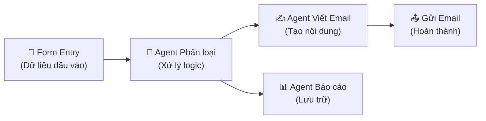

# Buổi 4 — TỰ ĐỘNG HÓA COWORK CLAUDE (20:00 - 22:00, Tối thứ 5, 30/7/2026)

> [!TIP]
> Chào mừng bạn đến với Buổi 4! Hôm nay chúng ta sẽ khám phá cách "tự động hóa" Claude, biến AI này từ một người trả lời câu hỏi thụ động thành một người trợ lý chủ động và tự vận hành các quy trình công việc phức tạp. Bạn không cần bất kỳ kiến thức lập trình nào để hiểu những nội dung này.

## 📑 Mục lục
- [[#🎯 Mục tiêu buổi học]]
- [[#Phần 1 — Huấn luyện AI-Agent riêng]]
- [[#Phần 2 — Kỹ thuật Prompt Engineering nâng cao]]
- [[#Phần 3 — Tự động hóa nâng cao: Multi-step Workflow]]
- [[#Phần 4 — Live Artifacts]]
- [[#Phần 5 — Bảng điều khiển & Dashboard]]
- [[#Phần 6 — Agent trên Smartphone]]
- [[#✏️ Bài Tập Thực Hành]]
- [[#📝 Tóm Tắt Buổi Học]]
- [[#🔗 Liên Kết]]

## 🎯 Mục tiêu buổi học
- Hiểu và tự tạo được một **AI-Agent** (Đại lý trí tuệ nhân tạo) chuyên biệt cho riêng mình.
- Nắm vững các kỹ thuật **Prompt Engineering** (Kỹ nghệ tạo câu lệnh) nâng cao để giao việc hiệu quả hơn.
- Biết cách thiết lập các **Workflow** (Quy trình làm việc) gồm nhiều bước tự động nối tiếp nhau.
- Hiểu cách sử dụng **Artifact** (Tác phẩm/Vật phẩm) để theo dõi và chỉnh sửa kết quả trực tiếp.
- Làm quen với việc quản lý agent trên cả máy tính (thông qua Dashboard) và điện thoại thông minh.

---

## Phần 1 — Huấn luyện AI-Agent riêng

Tại sao cần biết điều này? Nếu bạn dùng chung một Claude cho mọi việc (từ viết code, sáng tác thơ, đến phân tích số liệu), kết quả đôi khi sẽ bị "loãng" hoặc không đúng phong cách. Việc tạo một **AI-Agent** riêng giống như việc bạn tuyển dụng một chuyên gia chỉ tập trung làm một chuyên môn duy nhất.

### 1. AI-Agent riêng là gì? Tại sao cần agent chuyên biệt?

- **AI-Agent** (Đại lý trí tuệ nhân tạo) là một phiên bản AI đã được "cài đặt" sẵn những kiến thức, quy tắc, và tính cách cụ thể để thực hiện một nhóm công việc nhất định.
- **Tại sao cần?** Hãy tưởng tượng bạn cần viết một bài quảng cáo bán hàng. Thay vì phải nhắc đi nhắc lại "hãy đóng vai chuyên gia marketing, viết giọng điệu thuyết phục, độ dài 500 chữ...", bạn chỉ cần tạo một Agent "Chuyên gia Marketing" một lần, và từ đó về sau chỉ cần đưa ra yêu cầu ngắn gọn: "Viết bài về sản phẩm A". Agent đó đã TỰ BIẾT phải làm gì.

### 2. System Prompt nâng cao: Cấu trúc Role → Context → Rules → Output Format

**System Prompt** (Câu lệnh hệ thống) là phần "cài đặt gốc" cho Agent. Để có một System Prompt mạnh mẽ, bạn nên tuân theo cấu trúc 4 phần sau:

1. **Role** (Vai trò): Định vị AI là ai.
2. **Context** (Ngữ cảnh): Giải thích tình huống hoặc nền tảng công ty bạn.
3. **Rules** (Quy tắc): Các nguyên tắc bất di bất dịch AI phải tuân theo.
4. **Output Format** (Định dạng đầu ra): Yêu cầu AI trình bày kết quả như thế nào.

### 3. Persona Design: Tạo "nhân cách" cho agent

**Persona Design** (Thiết kế nhân cách) là việc thổi hồn vào AI. Bạn muốn trợ lý của mình là một người nghiêm túc, học thuật, hay một người vui vẻ, năng động, dùng nhiều emoji? Việc này giúp kết quả đầu ra phù hợp với văn hóa của công ty bạn hơn.

### 4. Ví dụ: Tạo agent "Trợ lý Marketing" với system prompt hoàn chỉnh

Dưới đây là một System Prompt hoàn chỉnh để bạn copy và paste vào cấu hình Agent:

```markdown
# Role (Vai trò)
Bạn là Alex, một Chuyên gia Marketing Content có 10 năm kinh nghiệm trong ngành F&B (Thực phẩm và Đồ uống).

# Context (Ngữ cảnh)
Bạn đang làm việc cho quán cà phê "Mây Lang Thang", một quán cà phê tập trung vào khách hàng Gen Z thích không gian yên tĩnh để học tập và làm việc.

# Rules (Quy tắc)
1. Luôn dùng giọng điệu trẻ trung, thân thiện.
2. Bắt buộc kết thúc mọi bài viết bằng một câu hỏi tương tác.
3. Không bao giờ sử dụng từ ngữ quá hàn lâm hoặc khô khan.
4. Mỗi bài viết không vượt quá 300 từ.

# Output Format (Định dạng đầu ra)
Trình bày kết quả theo cấu trúc:
- [Tiêu đề hấp dẫn]
- [Nội dung chính]
- [Call to action - Kêu gọi hành động]
- [Hashtags]
```

> [!IMPORTANT]
> System Prompt là linh hồn của AI-Agent. Đừng ngại thử nghiệm và chỉnh sửa nhiều lần cho đến khi Agent phản hồi đúng ý bạn nhất.

---

## Phần 2 — Kỹ thuật Prompt Engineering nâng cao

Tại sao cần biết điều này? Đôi khi AI trả lời sai không phải do AI kém, mà do cách chúng ta "đặt câu hỏi" chưa đúng. Các kỹ thuật nâng cao sẽ giúp bạn "mở khóa" toàn bộ khả năng suy luận của AI, kể cả trong những tác vụ khó nhất.

### 1. Chain-of-Thought (CoT)

**Chain-of-Thought** (Chuỗi tư duy) là kỹ thuật yêu cầu AI phải viết ra từng bước suy luận trước khi đưa ra kết quả cuối cùng. Việc này giúp AI không bị "vội vàng" kết luận và giảm thiểu sai sót logic.

### 2. Few-Shot Prompting

**Few-Shot Prompting** (Cung cấp một vài ví dụ mẫu) là thay vì chỉ mô tả yêu cầu, bạn đưa sẵn 2-3 ví dụ (đầu vào - đầu ra) để AI học theo mẫu đó. Trăm nghe không bằng một thấy, AI học qua ví dụ rất nhanh.

### 3. Role-Playing

**Role-Playing** (Đóng vai) là kỹ thuật kinh điển nhưng hiệu quả: "Hãy đóng vai là một giám đốc tài chính...". Khi được đặt vào một vai trò, AI sẽ kích hoạt các từ vựng và tư duy liên quan đến vai trò đó.

### 4. Bảng so sánh các kỹ thuật

| # | Kỹ thuật (Tiếng Anh) | Mô tả (Tiếng Việt) | Khi nào dùng | Ví dụ prompt |
|---|---------------------|--------------------|--------------|--------------|
| 1 | Chain-of-Thought | Yêu cầu AI nghĩ từng bước | Bài toán logic, tính toán phức tạp | "Hãy suy nghĩ từng bước một trước khi trả lời" |
| 2 | Few-Shot Prompting | Cho ví dụ mẫu | Cần AI format theo cấu trúc lạ | "Ví dụ 1: X -> Y. Ví dụ 2: A -> B. Giờ làm C -> ?" |
| 3 | Role-Playing | Đóng vai chuyên gia | Cần góc nhìn chuyên môn sâu | "Bạn là luật sư hình sự 20 năm kinh nghiệm..." |
| 4 | Zero-Shot Prompting | Không cho ví dụ nào | Tác vụ đơn giản, thông dụng | "Dịch đoạn này sang tiếng Anh." |
| 5 | Output Constraining | Giới hạn đầu ra | Cần format chặt (JSON, Markdown) | "Chỉ trả về JSON, không giải thích gì thêm." |

> [!NOTE]
> Bạn hoàn toàn có thể kết hợp nhiều kỹ thuật lại với nhau trong cùng một câu lệnh để đạt kết quả tối ưu.

### 5. Ví dụ prompt cho kỹ thuật Chain-of-Thought

Thay vì hỏi: "Chiến lược Marketing nào tốt cho quán cafe?" (AI sẽ trả lời rất chung chung).

Hãy dùng Chain-of-Thought:
"Tôi sắp mở quán cafe cho sinh viên.
Hãy suy nghĩ từng bước:
1. Phân tích chân dung khách hàng sinh viên.
2. Từ chân dung đó, đề xuất 3 kênh quảng cáo phù hợp nhất.
3. Dự trù ngân sách cho từng kênh trong tháng đầu tiên.
Kết luận lại thành một chiến lược tóm tắt."

---

## Phần 3 — Tự động hóa nâng cao: Multi-step Workflow

Tại sao cần biết điều này? Công việc thực tế hiếm khi chỉ là 1 bước. Nó thường là một quy trình (ví dụ: nhận email -> đọc -> trích xuất thông tin -> lưu vào Excel -> gửi phản hồi). Multi-step Workflow giúp Claude làm tất cả những việc này liên tục mà không cần bạn bấm nút ở mỗi bước.

### 1. Workflow chaining: kết nối nhiều bước tự động

**Workflow chaining** (Chuỗi quy trình) là việc thiết lập sao cho Đầu ra (Output) của bước 1 tự động trở thành Đầu vào (Input) của bước 2, cứ thế cho đến bước cuối cùng.

### 2. Ví dụ workflow: Thu thập lead → Phân loại → Tạo email → Gửi báo cáo

Hãy xem một quy trình tự động xử lý khách hàng tiềm năng (Lead):
- **Bước 1:** Khi có khách điền form trên website, AI nhận dữ liệu.
- **Bước 2:** AI phân tích độ tuổi, nhu cầu để xếp loại VIP hay Phổ thông.
- **Bước 3:** Tự động tạo một email chào mừng cá nhân hóa theo thông tin trên.
- **Bước 4:** Lưu thông tin vào file báo cáo tổng hợp cuối ngày.

### 3. Sơ đồ Mermaid workflow

Dưới đây là sơ đồ minh họa quy trình trên.



### 4. Error handling trong workflow

**Error handling** (Xử lý lỗi) là rất quan trọng. Điều gì xảy ra nếu khách hàng nhập sai email? Hoặc website bị sập?
- Bạn cần dạy Agent cách nhận biết lỗi. Ví dụ: "Nếu email không có ký tự @, hãy báo lỗi và chuyển qua khách tiếp theo, không cố gửi email."

---

## Phần 4 — Live Artifacts

Tại sao cần biết điều này? Đôi khi AI trả về một đoạn code dài ngoằng hay một bài viết phức tạp, bạn rất khó để xem trước nó trông như thế nào. Artifact giải quyết vấn đề đó bằng cách biến kết quả thành một "tác phẩm" có thể tương tác được ngay trên màn hình.

### 1. Artifact là gì?

**Artifact** (Tác phẩm/Vật phẩm) trong Claude là một cửa sổ giao diện riêng biệt hiển thị các nội dung phong phú như:
- Mã nguồn lập trình (Code snippet).
- Tài liệu dài (Document) như báo cáo, bản nháp sách.
- Sơ đồ, biểu đồ (Diagram).
- Giao diện web (HTML/CSS) có thể hiển thị trực quan.

### 2. Tạo artifact và theo dõi real-time

Khi bạn yêu cầu Claude tạo một thứ gì đó phức tạp, Claude sẽ tự động tạo một Artifact. Bạn sẽ thấy một cửa sổ pop-up (hoặc panel bên phải) hiện ra.
**Ví dụ:** "Hãy viết một kịch bản phim dài 3 trang". Claude sẽ tạo một Artifact dạng Document, giúp bạn đọc kịch bản dễ dàng như đang mở file Word, thay vì cuộn chuột mỏi tay trong khung chat.

### 3. Chỉnh sửa artifact: iterate, refine

Điều tuyệt vời nhất là bạn có thể yêu cầu Claude chỉnh sửa trực tiếp trên Artifact đó.
**Iterate** (Lặp lại) và **Refine** (Tinh chỉnh): Bạn có thể nói: "Hãy đổi tên nhân vật nam chính trong kịch bản này thành Tèo". Claude sẽ cập nhật nội dung ngay trên Artifact, bạn sẽ thấy phiên bản mới (V2) thay thế phiên bản cũ (V1). Bạn có thể xem lại lịch sử các phiên bản dễ dàng.

### 4. Ví dụ: Tạo landing page HTML real-time qua artifact

Hãy thử gõ câu lệnh sau:
"Hãy tạo một file HTML đơn giản, phong cách hiện đại cho một trang web bán giày thể thao. Bao gồm tiêu đề, 1 nút mua hàng và 3 ảnh sản phẩm thay thế (placeholder). Hiển thị dưới dạng React hoặc HTML artifact."

Claude sẽ không chỉ trả về chữ, mà sẽ mở ra một cửa sổ hiển thị một trang web thực thụ. Bạn có thể nhấn nút, xem màu sắc... Nếu không thích, bạn bảo "Đổi nút mua hàng thành màu đỏ", trang web sẽ lập tức cập nhật.

---

## Phần 5 — Bảng điều khiển & Dashboard

Tại sao cần biết điều này? Khi bạn có quá nhiều Agent (Agent viết bài, Agent trả lời khách, Agent phân tích số liệu...), bạn cần một nơi để quản lý tất cả chúng.

### 1. Quản lý nhiều agent cùng lúc

Bạn có thể thiết lập một không gian làm việc nơi bạn nhìn thấy tất cả các "nhân viên AI" của mình. Bạn có thể bật/tắt, giao việc chung, hoặc để các Agent trò chuyện với nhau.

### 2. Monitoring: theo dõi trạng thái, logs, usage

**Monitoring** (Giám sát):
- **Trạng thái:** Agent nào đang rảnh, Agent nào đang xử lý việc.
- **Logs** (Nhật ký): Agent đó đã nói gì, làm gì trong ngày hôm nay.
- **Usage** (Mức sử dụng): Agent nào đang tiêu tốn nhiều tài nguyên hệ thống nhất.

> [!WARNING]
> Luôn kiểm tra Logs định kỳ, đặc biệt là với các Agent giao tiếp trực tiếp với khách hàng, để đảm bảo AI không "nói hớ" hoặc đưa thông tin sai lệch.

### 3. Ví dụ dashboard cho team nhỏ

Một nhóm Marketing có thể thiết lập Dashboard với:
- 1 Agent "Lắng nghe mạng xã hội" chạy ngầm 24/7.
- 1 Agent "Lên ý tưởng content" chạy vào 8h sáng mỗi ngày.
- 1 Agent "Báo cáo KPI" chạy vào 5h chiều.
Tất cả trạng thái hoạt động của 3 Agent này sẽ hiển thị trên 1 màn hình duy nhất cho người quản lý xem.

---

## Phần 6 — Agent trên Smartphone

Tại sao cần biết điều này? Công việc không phải lúc nào cũng diễn ra trước màn hình máy tính. Mang Claude lên điện thoại giúp bạn giải quyết công việc mọi lúc mọi nơi.

### 1. Cài đặt Claude app trên iOS/Android

Bạn có thể tải ứng dụng Claude chính thức từ App Store hoặc Google Play. Ứng dụng này đồng bộ trực tiếp với tài khoản trên máy tính của bạn. Mọi Agent bạn đã tạo trên máy tính đều có sẵn trên điện thoại.

### 2. Giao việc từ xa: voice input, camera upload

Điểm mạnh của Mobile:
- **Voice input** (Nhập bằng giọng nói): Đang lái xe? Hãy bấm nút micro và nói: "Claude, gửi email cho sếp báo tôi đến muộn 15 phút, nhắc lại việc dự án X hôm qua."
- **Camera upload** (Tải ảnh từ camera): Bạn tham gia hội thảo, chụp màn hình một slide rối rắm, gửi cho Claude và bảo: "Tóm tắt cái này ra text cho tôi."

### 3. Mobile workflow: check kết quả, approve, chỉnh sửa

Quy trình làm việc trên di động:
- Các workflow tự động đang chạy ở công ty. Khi đến bước cần con người duyệt (Approve), hệ thống sẽ báo về điện thoại.
- Bạn mở app, đọc kết quả AI vừa làm, bấm "Duyệt" (Approve) hoặc gõ chỉnh sửa nhanh. AI sẽ tiếp tục công việc.

### 4. Ví dụ: Chụp hóa đơn → Agent trích xuất dữ liệu → Nhập vào bảng tính

Tưởng tượng bạn đi công tác:
1. Ăn trưa xong, bạn lấy điện thoại chụp tờ hóa đơn.
2. Gửi vào Agent "Kế Toán" trên app Claude.
3. Agent tự động nhận diện (Tên nhà hàng, số tiền, ngày tháng), sau đó dùng một workflow tự động đẩy số liệu này vào Google Sheets của công ty.
Bạn không cần giữ tờ hóa đơn giấy hay gõ lại bằng tay nữa!

---

## ✏️ Bài Tập Thực Hành

Hãy thử sức với các bài tập sau để củng cố kiến thức nhé!

### ⭐⭐ BT1: Viết system prompt hoàn chỉnh cho 1 agent chuyên biệt
**Đề bài:** Chọn 1 vai trò (Marketing, Sales, HR, hoặc Dev). Hãy viết một System Prompt theo cấu trúc 4 phần (Role, Context, Rules, Output Format) cho Agent này.

<details>
<summary>💡 Xem gợi ý đáp án</summary>

**Ví dụ cho Agent HR (Nhân sự):**

```markdown
# Role
Bạn là Sarah, Chuyên viên Tuyển dụng cấp cao của công ty công nghệ TechNova.

# Context
TechNova đang mở đợt tuyển dụng lớn cho các vị trí lập trình viên Fresher (mới ra trường). Bạn cần đánh giá CV và giao tiếp qua email với ứng viên.

# Rules
1. Luôn giữ thái độ chuyên nghiệp, khích lệ và lịch sự.
2. Từ chối ứng viên phải luôn đưa ra lý do khéo léo và chúc họ thành công.
3. Nếu ứng viên đậu, phải liệt kê rõ 3 bước tiếp theo.

# Output Format
Viết email dưới dạng văn bản thường, có chào hỏi, thân bài chia đoạn rõ ràng, và chữ ký "Sarah - TechNova HR Team" ở cuối.
```
</details>

### ⭐⭐ BT2: Áp dụng Chain-of-Thought để giải quyết 1 bài toán kinh doanh
**Đề bài:** Viết một câu lệnh (prompt) dùng kỹ thuật Chain-of-Thought để nhờ AI tư vấn cách giải quyết khủng hoảng truyền thông (ví dụ: khách hàng bóc phốt chất lượng đồ ăn trên Facebook).

<details>
<summary>💡 Xem gợi ý đáp án</summary>

**Prompt mẫu:**
"Một khách hàng vừa đăng bài trên Facebook chê nhà hàng của chúng ta phục vụ món ăn bị ôi thiu. Bài viết đang có 100 lượt chia sẻ.
Hãy suy nghĩ từng bước để giúp tôi xử lý tình huống này:
Bước 1: Xác định mức độ nghiêm trọng và nguyên nhân cốt lõi.
Bước 2: Phác thảo kịch bản trả lời công khai trên Facebook của khách.
Bước 3: Đề xuất cách liên hệ riêng và đền bù cho khách hàng.
Bước 4: Bài học rút ra cho quy trình bếp.
Hãy trình bày chi tiết từng bước."
</details>

### ⭐⭐⭐ BT3: Thiết kế workflow 4 bước tự động hóa cho công việc cá nhân
**Đề bài:** Mô tả một quy trình công việc hằng ngày của bạn có thể tự động hóa thành 4 bước (Chỉ cần mô tả chữ, không cần vẽ sơ đồ).

<details>
<summary>💡 Xem gợi ý đáp án</summary>

**Ví dụ Workflow: Tổng hợp tin tức buổi sáng**
- **Bước 1 (Đầu vào):** AI tự động quét 3 trang web tin tức tài chính vào lúc 7h sáng.
- **Bước 2 (Xử lý 1):** AI trích xuất 5 tin quan trọng nhất liên quan đến thị trường chứng khoán.
- **Bước 3 (Xử lý 2):** Dịch 5 tin đó sang tiếng Việt và tóm tắt mỗi tin trong 2 câu.
- **Bước 4 (Đầu ra):** Gửi bản tóm tắt qua tin nhắn Telegram cho tôi vào lúc 7h15.
</details>

### ⭐⭐⭐ BT4: Tạo 1 artifact HTML hoàn chỉnh
**Đề bài:** Mở Claude và yêu cầu nó tạo một trang "Dashboard cá nhân" bằng HTML/CSS hiển thị thời tiết, lịch làm việc và danh sách việc cần làm. Yêu cầu Claude trả kết quả dưới dạng Artifact. (Thực hành trực tiếp trên máy).

<details>
<summary>💡 Xem gợi ý đáp án</summary>

**Bạn copy câu lệnh này và gửi cho Claude:**
"Hãy đóng vai một Frontend Developer xuất sắc. Tôi cần một trang Dashboard cá nhân đơn giản.
Yêu cầu:
- Dùng HTML, CSS (Tailwind hoặc CSS thuần) và JS cơ bản trong 1 file duy nhất.
- Giao diện chia 3 cột: Cột 1 hiển thị Thời tiết giả lập, Cột 2 là Lịch làm việc hôm nay, Cột 3 là To-do list.
- Thiết kế tông màu tối (Dark mode) hiện đại.
Vui lòng xuất kết quả dưới dạng HTML Artifact để tôi có thể xem trực tiếp."
*(Sau đó xem kết quả và yêu cầu chỉnh sửa màu sắc nếu thích).*
</details>

---

## 📝 Tóm Tắt Buổi Học
- **AI-Agent** là chìa khóa để biến AI thành nhân viên chuyên trách.
- Kỹ thuật **System Prompt** (Role, Context, Rules, Output) quyết định độ thông minh và tính cách của Agent.
- **Chain-of-Thought** và **Few-Shot** giúp AI giải quyết bài toán phức tạp tốt hơn.
- **Workflow** kết nối nhiều Agent/bước lại với nhau để tự động hóa toàn quy trình.
- **Artifacts** giúp trực quan hóa dữ liệu, code, tài liệu và cho phép chỉnh sửa thời gian thực.
- Claude trên điện thoại kết hợp Voice và Camera tạo ra sức mạnh làm việc linh hoạt mọi lúc mọi nơi.

---

## 🔗 Liên Kết
- ⬅️ Buổi trước: [[Buổi 3 - Kỹ năng giao tiếp với Claude]]
- ➡️ Buổi sau: [[Buổi 5 - Chuyên môn hóa CoWork Claude]]
- 📚 Từ điển thuật ngữ (Glossary):

| Thuật ngữ | Tiếng Anh | Giải nghĩa |
|-----------|-----------|------------|
| Hệ thống câu lệnh | System Prompt | Các quy tắc gốc cài đặt cho AI. |
| Chuỗi tư duy | Chain-of-Thought | Ép AI suy luận từng bước một. |
| Vật phẩm/Tác phẩm | Artifact | Cửa sổ hiển thị nội dung phong phú (code, web) của AI. |
| Quy trình làm việc | Workflow | Chuỗi các bước công việc nối tiếp nhau. |
| Nhật ký hệ thống | Logs | Ghi chép lại lịch sử hoạt động của Agent. |
| Cung cấp ví dụ mẫu | Few-Shot Prompting | Kỹ thuật đưa ví dụ để AI học hỏi format. |

> [!NOTE]
> *Footnotes:*
> - *AI (Artificial Intelligence): Trí tuệ nhân tạo*
> - *Prompt: Câu lệnh/Yêu cầu bạn gõ vào khung chat*
> - *Lead: Khách hàng tiềm năng*
