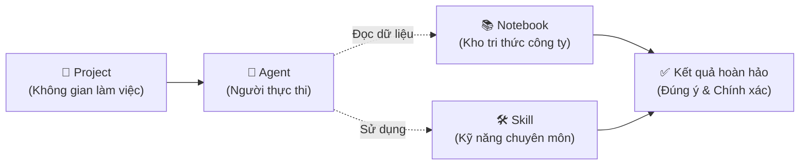

# Buổi 5 — CHUYÊN MÔN HÓA COWORK CLAUDE (08:00 - 11:00, Sáng chủ nhật 02/8/2026)

> [!TIP]
> Chào buổi sáng! Trong bài học trước, chúng ta đã biết cách tạo ra các Agent tự động hóa. Hôm nay, chúng ta sẽ "trang bị vũ khí" cho các Agent đó bằng **Skill** (Kỹ năng) và **Notebook** (Sổ tay kiến thức). Đây là bước quyết định để AI của bạn khác biệt hoàn toàn so với phiên bản AI phổ thông ngoài kia.

## 📑 Mục lục
- [[#🎯 Mục tiêu buổi học]]
- [[#Phần 1 — Skill là gì?]]
- [[#Phần 2 — Cấu trúc Skill chi tiết]]
- [[#Phần 3 — Tạo Skill cơ bản]]
- [[#Phần 4 — Skill chuyên sâu]]
- [[#Phần 5 — Xây dựng Kho Notebook/LM]]
- [[#Phần 6 — Hệ sinh thái: Project + Skill + Notebook]]
- [[#✏️ Bài Tập Thực Hành]]
- [[#📝 Tóm Tắt Buổi Học]]
- [[#🔗 Liên Kết]]

## 🎯 Mục tiêu buổi học
- Hiểu rõ khái niệm **Skill** (Kỹ năng) và sự khác biệt so với System Prompt.
- Nắm vững cấu trúc thư mục của một Skill và cách viết file `SKILL.md`.
- Biết cách quản lý kiến thức bằng **Notebook**.
- Có khả năng thiết lập một hệ sinh thái hoàn chỉnh kết hợp **Project**, **Skill**, và **Notebook** để giải quyết công việc thực tế.

---

## Phần 1 — Skill là gì?

Tại sao cần biết điều này? Nếu System Prompt định hình "tính cách" của Agent, thì Skill chính là "tay nghề" của Agent. Một người thợ mộc tốt (Agent) cần phải có những kỹ năng chuyên môn như đục, cưa, bào (Skills) để làm ra sản phẩm.

### 1. Khái niệm Skill trong hệ sinh thái CoWork/Claude

**Skill** (Kỹ năng) là một bộ hướng dẫn chuyên biệt, được đóng gói gọn gàng thành các file/thư mục, nhằm mục đích dạy cho Agent cách thực hiện TỐT NHẤT một nhiệm vụ cụ thể lặp đi lặp lại.
Ví dụ: Kỹ năng "Viết email xin lỗi khách hàng", Kỹ năng "Phân tích báo cáo tài chính".

### 2. Skill = bộ hướng dẫn chuyên biệt

Thay vì mỗi lần làm việc bạn phải nhắc lại hàng loạt quy tắc, bạn gói tất cả quy tắc, ví dụ mẫu, và cách thức làm việc vào một gói Skill. Khi cần, Agent chỉ việc "tải" Skill này lên và sử dụng.

### 3. So sánh: Skill vs Custom Instructions vs System Prompt

| # | Khái niệm | Đóng vai trò như... | Độ linh hoạt | Khi nào dùng? |
|---|-----------|---------------------|--------------|---------------|
| 1 | **System Prompt** | "Nhân cách", quy tắc cốt lõi của Agent | Ít thay đổi | Khi thiết lập AI-Agent lần đầu. (Ví dụ: Bạn là Kế toán trưởng) |
| 2 | **Custom Instructions** | Những lưu ý riêng của cá nhân bạn | Thay đổi tùy người | Ghi chú cá nhân (Ví dụ: "Hãy xưng hô là Anh/Em", "Luôn in đậm tên") |
| 3 | **Skill** | "Tay nghề", bộ công cụ chuyên môn | Có thể gọi/tắt linh hoạt | Giao nhiệm vụ cụ thể. (Ví dụ: Gọi kỹ năng "Tính lương tháng") |

### 4. Tại sao Skill quan trọng?

- **Tái sử dụng:** Viết 1 lần, dùng mãi mãi.
- **Chia sẻ:** Bạn có thể copy thư mục Skill của mình gửi cho đồng nghiệp để họ sử dụng.
- **Module hóa:** Giúp Agent không bị quá tải thông tin. Agent chỉ "học" kỹ năng nào cần thiết cho nhiệm vụ hiện tại.

---

## Phần 2 — Cấu trúc Skill chi tiết

Tại sao cần biết điều này? Skill không chỉ là một dòng chữ, nó là một thư mục có cấu trúc. Việc tổ chức đúng chuẩn giúp hệ thống Claude CoWork đọc và hiểu được tài liệu của bạn một cách chính xác.

### 1. File SKILL.md: Frontmatter YAML + Markdown

Trái tim của mọi Skill là file `SKILL.md`. File này luôn gồm 2 phần:
- **Frontmatter YAML:** Phần khai báo thông tin kỹ thuật (tên, mô tả) ở đầu file, nằm giữa 2 đường gạch `---`.
- **Markdown instructions:** Phần nội dung hướng dẫn chi tiết bên dưới.

### 2. Cấu trúc folder Skill tiêu chuẩn

Một Skill chuyên nghiệp sẽ được đặt trong một thư mục (folder) như sau:

```bash
my-skill/
├── SKILL.md          ← File chính chứa hướng dẫn (bắt buộc)
├── scripts/          ← Thư mục chứa các đoạn code tự động hóa (VD: python)
├── examples/         ← Thư mục chứa các ví dụ mẫu (đầu vào - đầu ra)
├── resources/        ← Tài nguyên tham khảo (biểu mẫu, template)
└── references/       ← Tài liệu nghiên cứu, sách hướng dẫn liên quan
```

### 3. Giải thích từng thành phần

- **`SKILL.md`:** AI sẽ đọc file này đầu tiên để biết phải làm gì.
- **`scripts/`:** Dành cho người dùng nâng cao (coder). Chứa code để AI tự chạy (VD: script tải ảnh từ web).
- **`examples/`:** Rất quan trọng! Bạn để vào đây các bài mẫu xuất sắc nhất để AI bắt chước.
- **`resources/` & `references/`:** Chứa tài liệu bổ sung nếu tác vụ cần tham khảo dữ liệu bên ngoài.

---

## Phần 3 — Tạo Skill cơ bản

Tại sao cần biết điều này? Bắt đầu từ những thứ đơn giản nhất. Chúng ta sẽ tạo một Skill giúp bạn không bao giờ phải nhức đầu nghĩ cách viết báo cáo tuần nữa.

### 1. Step-by-step tạo Skill đầu tiên: "Weekly Report Generator"

- **Bước 1:** Tạo một thư mục mới trên máy tính đặt tên là `weekly-report-skill`.
- **Bước 2:** Mở trình soạn thảo văn bản (Notepad, VSCode), tạo một file tên là `SKILL.md`.
- **Bước 3:** Viết nội dung hướng dẫn và lưu vào thư mục trên.

### 2. Viết SKILL.md hoàn chỉnh với YAML frontmatter

Dưới đây là nội dung mẫu cho file `SKILL.md`:

```markdown
---
name: Weekly Report Generator
description: Kỹ năng giúp tự động tổng hợp công việc trong tuần thành báo cáo chuyên nghiệp gửi sếp.
version: 1.0
---

# Hướng dẫn Kỹ năng Báo cáo tuần

## Nhiệm vụ của bạn
Khi được yêu cầu làm báo cáo tuần, hãy hỏi người dùng cung cấp danh sách gạch đầu dòng các việc họ đã làm. Sau đó chuyển hóa chúng thành một email báo cáo chuyên nghiệp.

## Quy tắc định dạng (Rules)
1. Bắt buộc có phần: "1. Công việc hoàn thành", "2. Vấn đề tồn đọng", "3. Kế hoạch tuần tới".
2. Giọng điệu chuyên nghiệp, khiêm tốn.
3. Nếu người dùng không nhắc đến "Kế hoạch tuần tới", hãy tự động gợi ý 2 việc liên quan.

## Output mong muốn
Trả về toàn bộ nội dung dưới dạng văn bản có thể copy thẳng vào Gmail.
```

### 3. Test Skill: cách kích hoạt và kiểm tra

Trong giao diện Claude CoWork, bạn kéo thả thư mục `weekly-report-skill` vào phần Quản lý Skill.
Sau đó, hãy chat: "Dùng kỹ năng Weekly Report, viết cho tôi báo cáo dựa trên: họp 3 buổi, code xong tính năng đăng nhập, bị kẹt bug ở phần thanh toán". AI sẽ áp dụng đúng quy tắc bạn đã viết trong file `SKILL.md`.

---

## Phần 4 — Skill chuyên sâu

Tại sao cần biết điều này? Khi bạn đã quen với Skill cơ bản, việc thêm dữ liệu mẫu và các công cụ bổ trợ sẽ nâng cấp Agent của bạn từ mức "Biết việc" lên mức "Chuyên gia".

### 1. Thêm examples/ cho agent tham khảo

Bên trong thư mục Skill, hãy tạo thư mục `examples/`. Bỏ vào đó 1 file `mau-bao-cao-gioi.txt`. AI sẽ tự động đọc file này trước khi làm việc, giúp kết quả đầu ra giống với phong cách bạn mong muốn đến 99%.

### 2. Thêm resources/ (templates, data)

Nếu bạn làm Skill "Phân tích tài chính", bạn có thể bỏ các file Excel biểu mẫu (Template) trắng vào thư mục `resources/`. AI sẽ biết lấy biểu mẫu đó ra để điền số liệu vào thay vì tạo một bảng mới hoàn toàn.

### 3. Thêm scripts/ automation (bash, python)

(Dành cho người biết lập trình): Bạn có thể viết một đoạn code Python đặt trong thư mục `scripts/`. Trong `SKILL.md`, bạn dạy AI: "Khi cần tính toán, hãy chạy file `scripts/tinh_toan.py`". Lúc này, AI của bạn không chỉ nói chuyện, mà còn có khả năng "hành động".

### 4. Ví dụ: Skill "SEO Content Writer" phức tạp

Một thư mục Skill SEO hoàn chỉnh:
- `SKILL.md`: Hướng dẫn nguyên tắc viết bài (mật độ từ khóa 2%, tiêu đề < 65 ký tự).
- `examples/bai-viet-top-1.md`: Một bài viết mẫu đã từng lên Top 1 Google.
- `resources/danh-sach-tu-khoa-cam.txt`: Danh sách các từ ngữ không được phép sử dụng.
Khi chạy Skill này, AI sẽ tổng hợp mọi thông tin lại để viết ra một bài viết chuẩn SEO hoàn hảo.

---

## Phần 5 — Xây dựng Kho Notebook/LM

Tại sao cần biết điều này? Agent thông minh cần có kiến thức để hoạt động. Notebook chính là bộ não lưu trữ tri thức của doanh nghiệp bạn.

### 1. Notebook là gì? LM (Language Model) notebook

**Notebook** (Sổ tay) trong ngữ cảnh này không phải sổ tay giấy, mà là một kho chứa tài liệu số (PDF, Word, TXT, Markdown) được mã hóa sao cho Trí tuệ nhân tạo (LM) có thể đọc và hiểu ngay lập tức.

### 2. Tổ chức knowledge base cá nhân

**Knowledge base** (Cơ sở tri thức) là nơi tập hợp mọi thứ: Cẩm nang nhân sự, Lịch sử công ty, Hướng dẫn sử dụng sản phẩm.
Thay vì bắt AI tự lên mạng tìm kiếm (có thể sai lệch), bạn tải toàn bộ tài liệu chuẩn của công ty vào Notebook.

### 3. Best practices quản lý Notebook

- **Phân loại rõ ràng:** Đừng bỏ tất cả vào 1 Notebook. Hãy tạo "Notebook Nhân sự", "Notebook Sản phẩm", "Notebook Khách hàng".
- **Cập nhật thường xuyên:** Khi có chính sách mới, phải xóa file cũ trong Notebook và cập nhật file mới, nếu không AI sẽ tư vấn sai.
- **Sử dụng Markdown:** AI đọc định dạng `.md` (Markdown) tốt và nhanh hơn đọc file PDF rất nhiều.

### 4. Ví dụ: Notebook cho team Marketing gồm những gì

Một "Sổ tay Marketing" chuẩn sẽ chứa:
- File `Brand-Guidelines.pdf` (Quy định màu sắc, logo).
- File `Chan-dung-khach-hang.md` (Mô tả chi tiết khách hàng mục tiêu).
- File `Lich-su-chien-dich-2025.xlsx` (Kết quả các chiến dịch cũ).

---

## Phần 6 — Hệ sinh thái: Project + Skill + Notebook

Tại sao cần biết điều này? Đây là bức tranh toàn cảnh! Khi bạn ghép các mảnh lego riêng lẻ (Dự án, Kỹ năng, Kiến thức) lại với nhau, bạn tạo ra một Cỗ máy tự động hóa thực thụ.

### 1. Kết hợp 3 thành phần thành hệ thống hoàn chỉnh

1. **Project (Dự án):** Là không gian làm việc chung. Nơi nhận yêu cầu.
2. **Notebook (Sổ tay):** Đóng vai trò là "Thư viện" cung cấp dữ liệu, sự thật.
3. **Skill (Kỹ năng):** Đóng vai trò là "Công cụ" xử lý dữ liệu từ Thư viện.

### 2. Sơ đồ Mermaid hệ sinh thái



### 3. Workflow: Project gọi Skill, Skill dùng Notebook

Tưởng tượng luồng công việc:
- Bạn mở **Project** "Chăm sóc khách hàng".
- Bạn yêu cầu Agent trả lời khiếu nại của khách.
- Agent tự động kích hoạt **Skill** "Xử lý khủng hoảng".
- Để biết chính sách hoàn tiền, Agent (đang chạy Skill) tự động lật **Notebook** "Chính sách công ty 2026" ra để đọc.
- Cuối cùng, Agent soạn ra một email chuẩn chỉnh, đúng chính sách và làm khách hàng hài lòng.

### 4. Ví dụ thực tế: Hệ thống "Content Marketing Automation"

Doanh nghiệp thiết lập:
- **Notebook:** Chứa thông tin chi tiết về sản phẩm Bất động sản A.
- **Skill:** Kỹ năng viết bài chuẩn SEO Facebook.
- Mỗi sáng, người quản lý chỉ vào **Project** gõ 1 câu: "Viết bài Facebook hôm nay".
- Hệ thống tự động lấy dữ liệu từ Notebook, lắp vào khung của Skill, và trả ra bài viết sẵn sàng để đăng tải. Chỉ tốn 5 giây!

---

## ✏️ Bài Tập Thực Hành

Hãy bắt tay vào làm để biến lý thuyết thành hệ thống của riêng bạn!

### ⭐ BT1: Tạo 1 Skill cơ bản "Email Drafter" với SKILL.md
**Đề bài:** Tạo cấu trúc thư mục cho một Skill tên là "email-drafter". Viết file `SKILL.md` yêu cầu AI: "Luôn kiểm tra lỗi chính tả và format email với lời chào, nội dung, và lời cảm ơn cuối thư."

<details>
<summary>💡 Xem gợi ý đáp án</summary>

Tạo file `email-drafter/SKILL.md` với nội dung:
```markdown
---
name: Email Drafter
description: Kỹ năng soạn thảo email chuyên nghiệp, không lỗi chính tả.
---

# Hướng dẫn
Khi người dùng đưa ra một ý tưởng ngắn, hãy biến nó thành email hoàn chỉnh.

## Quy tắc bắt buộc
1. Rà soát và sửa mọi lỗi chính tả từ ý tưởng gốc.
2. Cấu trúc email bắt buộc:
   - Lời chào (Ví dụ: Kính gửi Anh/Chị...)
   - Nội dung chính (Rõ ràng, mạch lạc)
   - Lời cảm ơn và Chữ ký chân phương.
```
</details>

### ⭐⭐ BT2: Thêm folder examples/ với 3 ví dụ email mẫu
**Đề bài:** Tiếp tục từ BT1. Hãy tạo thư mục `examples` bên trong thư mục `email-drafter`. Tạo 1 file `mau-tot.md` cung cấp cho AI một ví dụ về email xin nghỉ phép chuẩn mực.

<details>
<summary>💡 Xem gợi ý đáp án</summary>

Trong thư mục `email-drafter/examples/`, tạo file `mau-tot.md`:
```markdown
[Đầu vào của người dùng]
Sếp ơi mai em bệnh xin nghỉ 1 bữa nha.

[Đầu ra hoàn hảo]
Kính gửi Trưởng phòng,

Em viết email này xin phép anh/chị cho em được nghỉ phép 1 ngày vào ngày mai [Ngày/Tháng/Năm] do lý do sức khỏe cá nhân. 
Trong thời gian nghỉ, nếu có việc gấp, anh/chị có thể liên hệ em qua điện thoại. Mọi công việc hiện tại em đã bàn giao cho bạn [Tên đồng nghiệp].

Em cảm ơn anh/chị.
Trân trọng,
[Tên của bạn]
```
</details>

### ⭐⭐⭐ BT3: Tạo Skill nâng cao có scripts/ tự động hóa
**Đề bài:** (Bài tập tư duy) Nếu bạn cần làm một Skill có tên "Tải và Phân tích Video Youtube". Bạn sẽ thiết kế cấu trúc thư mục Skill này như thế nào? Thư mục `scripts` sẽ chứa công cụ gì?

<details>
<summary>💡 Xem gợi ý đáp án</summary>

Cấu trúc gợi ý:
```bash
youtube-analyzer/
├── SKILL.md (Hướng dẫn AI: Chạy script lấy sub -> Tóm tắt)
├── scripts/
│   └── download_subtitle.py (Đoạn code Python dùng thư viện pytube để lấy phụ đề)
└── examples/
    └── mau-tom-tat-video.md (Mẫu tóm tắt gạch đầu dòng)
```
*Ghi chú: Bạn không cần viết code thật, chỉ cần hiểu vai trò của thư mục scripts là để chứa các công cụ lập trình giúp AI thao tác với hệ thống bên ngoài.*
</details>

### ⭐⭐⭐ BT4: Xây dựng hệ thống Project + Skill + Notebook cho 1 use case thực tế
**Đề bài:** Vẽ trên giấy (hoặc mô tả bằng chữ) một hệ thống gồm Project + 1 Notebook + 1 Skill dành cho vị trí "Nhân viên Bán hàng (Sales)".

<details>
<summary>💡 Xem gợi ý đáp án</summary>

**Hệ thống Sales Automation:**
1. **Notebook (Sổ tay):** Đặt tên là `Product_Knowledge_Base`. Chứa các file PDF bảng giá sản phẩm, chính sách bảo hành, danh sách câu hỏi thường gặp (FAQ).
2. **Skill (Kỹ năng):** Đặt tên là `Objection_Handling_Skill` (Kỹ năng xử lý từ chối). Cấu hình để AI biết cách dùng ngôn từ mềm mỏng, thuyết phục.
3. **Project:** Khi khách hàng nhắn tin chê "Giá đắt quá", người bán hàng đưa câu đó vào Project. Agent sẽ tự dùng `Objection_Handling_Skill`, tra cứu bảng so sánh tính năng trong `Product_Knowledge_Base`, và đưa ra câu trả lời thuyết phục khách hàng ngay lập tức.
</details>

---

## 📝 Tóm Tắt Buổi Học
- **Skill (Kỹ năng):** Là bộ công cụ chuyên môn được đóng gói thành thư mục. Giúp Agent tái sử dụng tri thức và làm việc nhất quán.
- **Cấu trúc Skill:** Luôn có `SKILL.md` (frontmatter YAML), có thể kèm thêm các thư mục bổ trợ như `examples/`, `resources/`, `scripts/`.
- **Notebook (Sổ tay):** Đóng vai trò là "não bộ lưu trữ" (Knowledge base), chứa dữ liệu, văn bản, chính sách nội bộ để AI truy xuất dữ liệu thực tế.
- **Hệ sinh thái CoWork:** Là sự kết hợp hoàn hảo giữa **Project** (Môi trường) + **Notebook** (Dữ liệu) + **Skill** (Công cụ xử lý). Nắm vững tam giác này, bạn có thể tự động hóa hầu hết công việc bàn giấy!

---

## 🔗 Liên Kết
- ⬅️ Buổi trước: [[Buổi 4 - Tự động hóa CoWork Claude]]
- ➡️ Buổi sau: [[Buổi 6 - Bảo mật & Tối ưu hóa chi phí]]
- 📚 Từ điển thuật ngữ (Glossary):

| Thuật ngữ | Tiếng Anh | Giải nghĩa |
|-----------|-----------|------------|
| Kỹ năng | Skill | Gói hướng dẫn chuyên sâu cho Agent. |
| Phần thông tin đầu | Frontmatter | Cấu hình YAML (tên, mô tả) ở đầu file Markdown. |
| Sổ tay kiến thức | Notebook | Kho lưu trữ tài liệu nội bộ cho AI đọc. |
| Cơ sở tri thức | Knowledge Base | Tập hợp toàn bộ dữ liệu, quy định của tổ chức. |
| Mô hình ngôn ngữ | Language Model (LM) | Cốt lõi của AI (ví dụ: mô hình Claude). |
| Trường hợp sử dụng | Use case | Một tình huống áp dụng thực tế cụ thể. |

> [!NOTE]
> *Footnotes:*
> - *YAML: Một ngôn ngữ định dạng dữ liệu, thường dùng để viết file cấu hình.*
> - *Markdown (.md): Định dạng văn bản đơn giản dùng để tạo tài liệu dễ đọc cho cả người và máy.*
