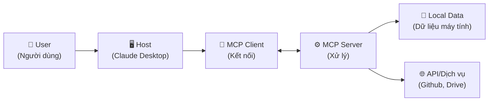

# Buổi 6 — MỞ RỘNG COWORK CLAUDE

## 📑 Mục lục
- [[#🎯 Mục tiêu buổi học]]
- [[#Phần 1 — API Kết nối nền tảng]]
- [[#Phần 2 — MCP (Model Context Protocol)]]
- [[#Phần 3 — Case Study Viết sách với CoWork]]
- [[#Phần 4 — Case Study Kiếm tiền với CoWork]]
- [[#Phần 5 — Best Practices Mẹo]]
- [[#Phần 6 — Tổng kết Lộ trình tiếp theo]]
- [[#✏️ Bài Tập Thực Hành]]
- [[#📝 Tóm Tắt Buổi Học]]
- [[#🔗 Liên Kết]]

## 🎯 Mục tiêu buổi học
- Hiểu được API là gì và cách kết nối CoWork với các nền tảng khác.
- Nắm bắt kiến trúc của MCP (Model Context Protocol) và cách thiết lập cơ bản.
- Áp dụng Workflow (Quy trình làm việc) vào các dự án lớn như viết sách, tạo automation.
- Khám phá các cơ hội kiếm tiền và phát triển dịch vụ từ kỹ năng CoWork.
- Nắm vững các mẹo tối ưu chi phí và nâng cao hiệu suất làm việc với Agent.

---

## Phần 1 — API & Kết nối nền tảng

### Tại sao cần biết điều này?
Khi bạn làm việc với **Claude CoWork**, sẽ có lúc bạn muốn Claude tự động lấy dữ liệu từ một trang web khác, hoặc gửi tin nhắn vào nhóm Slack khi công việc hoàn thành. Đó là lúc chúng ta cần dùng tới **API**.

### API là gì? REST API giải thích cho người mới

**API (Application Programming Interface - Giao diện lập trình ứng dụng)** giống như một người phục vụ trong nhà hàng.
- Bạn (người dùng) xem thực đơn và gọi món.
- Phục vụ (API) mang yêu cầu của bạn vào bếp.
- Bếp (Hệ thống/Server) nấu món ăn.
- Phục vụ (API) mang thức ăn ra cho bạn.

**REST API (Representational State Transfer API)** là chuẩn giao tiếp phổ biến nhất hiện nay trên Internet. Nó sử dụng các phương thức HTTP như:
- `GET`: Lấy thông tin (Xem menu)
- `POST`: Gửi thông tin mới (Đặt món)
- `PUT/PATCH`: Cập nhật thông tin (Đổi món)
- `DELETE`: Xóa thông tin (Hủy món)

> [!NOTE]
> REST API trả về dữ liệu thường ở định dạng **JSON** (một cách sắp xếp dữ liệu dễ đọc bằng các cặp chìa khóa - giá trị). Ví dụ: `{"ten": "Claude", "tuoi": 2}`.

### Anthropic API: Lấy API key, authentication

Để sử dụng dịch vụ của Anthropic từ bên ngoài (hoặc tích hợp vào CoWork để mở rộng), bạn cần **API Key** (Chìa khóa API). Đây là "chứng minh nhân dân" của bạn để hệ thống biết bạn là ai và tính phí (nếu có).

**Các bước lấy API Key:**
1. Truy cập [console.anthropic.com](https://console.anthropic.com/)
2. Đăng nhập hoặc tạo tài khoản mới.
3. Chuyển đến phần **API Keys**.
4. Nhấn **Create Key** (Tạo khóa) và đặt tên cho nó (VD: `CoWork_Test`).
5. Copy đoạn mã dài (bắt đầu bằng `sk-ant-...`) và lưu vào nơi an toàn.

> [!WARNING]
> **Tuyệt đối không** chia sẻ API Key này cho ai, không đăng lên mạng xã hội hay Github. Nếu lộ, người khác có thể dùng tiền của bạn!

### Ví dụ gọi API đơn giản

**Bằng lệnh curl (Dùng trong Terminal/Command Prompt):**
```bash
curl https://api.anthropic.com/v1/messages \
     --header "x-api-key: sk-ant-your-api-key-here" \
     --header "anthropic-version: 2023-06-01" \
     --header "content-type: application/json" \
     --data '{
         "model": "claude-3-5-sonnet-20241022",
         "max_tokens": 1024,
         "messages": [
             {"role": "user", "content": "Xin chào, bạn tên là gì?"}
         ]
     }'
```

**Bằng Python:**
```python
import anthropic

client = anthropic.Anthropic(
    api_key="sk-ant-your-api-key-here"
)

message = client.messages.create(
    model="claude-3-5-sonnet-20241022",
    max_tokens=1024,
    messages=[
        {"role": "user", "content": "Xin chào, bạn tên là gì?"}
    ]
)
print(message.content)
```

### Webhook: Nhận thông báo tự động

**Webhook (Móc web)** là một cơ chế giúp một ứng dụng *tự động* báo cho ứng dụng khác biết khi có sự kiện xảy ra, thay vì phải liên tục hỏi "Có gì mới không?".
Ví dụ: Khi khách hàng thanh toán thành công, ngân hàng sẽ bắn một Webhook về hệ thống của bạn để kích hoạt khóa học. Trong CoWork, bạn có thể thiết lập Webhook để Claude tự động xử lý khi nhận được email hoặc thông báo mới.

---

## Phần 2 — MCP (Model Context Protocol)

### MCP là gì? Tại sao MCP quan trọng?

**MCP (Model Context Protocol - Giao thức ngữ cảnh mô hình)** là một tiêu chuẩn mở do Anthropic giới thiệu. Nó là cầu nối an toàn giúp các AI model (như Claude) truy cập vào dữ liệu của bạn, cho dù dữ liệu đó nằm trên máy tính cá nhân, trên Google Drive hay Github, mà không cần phải tải toàn bộ dữ liệu đó lên nền tảng của Anthropic.

**Tại sao nó quan trọng?**
- **Bảo mật**: Dữ liệu nằm ở máy bạn, bạn kiểm soát quyền truy cập.
- **Tiện lợi**: AI có thể "đọc" thư mục, file, hoặc kết nối tới các dịch vụ cục bộ trực tiếp.
- **Tiêu chuẩn hóa**: Bất kỳ AI nào hỗ trợ MCP đều có thể dùng chung một hệ sinh thái kết nối.

### Kiến trúc MCP: Host → Client → Server → Tools

Mô hình hoạt động của MCP gồm các thành phần:
1. **Host (Máy chủ lưu trữ)**: Ứng dụng mà bạn đang dùng, ví dụ như Claude Desktop.
2. **Client (Máy khách MCP)**: Phần mềm nằm trong Host để thiết lập kết nối 2 chiều.
3. **Server (Máy chủ MCP)**: Ứng dụng nhỏ chạy trên máy tính của bạn hoặc trên mạng, giữ nhiệm vụ cung cấp dữ liệu.
4. **Resources/Tools (Tài nguyên/Công cụ)**: Những khả năng mà Server cung cấp (ví dụ: Tool đọc file, Tool tìm kiếm).

### Sơ đồ Mermaid kiến trúc MCP



### Các MCP server phổ biến

- **Filesystem**: Cho phép AI đọc, viết, tìm kiếm file trên máy tính của bạn một cách an toàn.
- **Github**: Cho phép đọc code, tạo PR, quản lý issue trên kho lưu trữ Github.
- **Google Calendar/Drive**: Đọc lịch trình, tạo cuộc họp, tìm kiếm tài liệu trên Google.
- **PostgreSQL/SQLite**: Truy vấn trực tiếp vào cơ sở dữ liệu.

### Hướng dẫn setup MCP server đầu tiên (filesystem)

Đây là cách tích hợp MCP Server quản lý file vào Claude Desktop (trên máy Mac hoặc Windows):

1. Mở file cấu hình của Claude Desktop:
   - Mac: `~/Library/Application Support/Claude/claude_desktop_config.json`
   - Windows: `%APPDATA%\Claude\claude_desktop_config.json`
2. Thêm cấu hình sau:
```json
{
  "mcpServers": {
    "filesystem": {
      "command": "npx",
      "args": [
        "-y",
        "@modelcontextprotocol/server-filesystem",
        "C:\\Users\\ryant\\Desktop\\MyProject"
      ]
    }
  }
}
```
*(Trong đó đường dẫn `C:\\Users...` là thư mục bạn cho phép AI truy cập).*
3. Khởi động lại Claude Desktop. Lúc này, AI sẽ có thêm một "Tool" là đọc/ghi file trong thư mục đó!

---

## Phần 3 — Case Study: Viết sách với CoWork

### Tại sao cần biết điều này?
Viết một cuốn sách cần rất nhiều thời gian và sự tổ chức. Việc sử dụng AI như một "Co-writer" (Đồng tác giả) và "Editor" (Biên tập viên) sẽ tăng tốc quá trình này lên gấp 10 lần.

### Workflow viết sách A-Z

Chúng ta sẽ không yêu cầu AI "viết cho tôi một cuốn sách", vì nó sẽ ra một đống chữ chung chung và hời hợt. Hãy chia nhỏ:

- ① **Lên ý tưởng & outline**: Brainstorm cùng AI, xây dựng mục lục chi tiết.
- ② **Research & thu thập tài liệu**: Dùng tính năng Web Search hoặc tải PDF lên để AI tóm tắt.
- ③ **Viết từng chương**: Yêu cầu AI viết từng đoạn, từng phần nhỏ dựa trên outline.
- ④ **Review & chỉnh sửa**: Đưa bản nháp để AI kiểm tra lỗi logic, văn phong.
- ⑤ **Format & xuất bản**: Sử dụng Tool để định dạng lại văn bản thành Markdown hoặc PDF.

### Prompt template cho từng bước

**Bước 1: Lên Outline**
> "Bạn là một tác giả sách bán chạy (Bestseller). Hãy giúp tôi tạo một mục lục chi tiết (Outline) cho cuốn sách có chủ đề: [Chủ đề của bạn]. Đối tượng độc giả là: [Ai đọc sách này]. Hãy chia sách thành 3 phần chính, mỗi phần có 3-4 chương. Với mỗi chương, nêu ra 3 ý chính cần giải quyết."

**Bước 3: Viết từng chương**
> "Dựa trên outline sau: [Dán outline chương 1 vào], hãy viết bản nháp cho Phần 1 của Chương 1. Văn phong: chuyên nghiệp nhưng gần gũi, nhiều ví dụ thực tế. Không viết phần kết luận vội. Độ dài tối thiểu 1000 từ."

### Ví dụ: Outline sách "Tự động hóa công việc với AI"

<details>
<summary>💡 Xem ví dụ mẫu Outline do AI tạo</summary>

**Phần 1: Nền tảng tư duy tự động hóa**
- Chương 1: Kỷ nguyên mới của làm việc thông minh
- Chương 2: Hiểu đúng về AI (LLM, Prompt, Agent)
- Chương 3: Khung đánh giá công việc có thể tự động hóa

**Phần 2: Ứng dụng thực chiến**
- Chương 4: Tự động hóa Email và Giao tiếp
- Chương 5: Phân tích và xử lý dữ liệu hàng loạt
- Chương 6: Viết lách và sáng tạo nội dung siêu tốc

**Phần 3: Quản lý hệ thống**
- Chương 7: Xây dựng AI Agent cá nhân với CoWork
- Chương 8: Rủi ro, bảo mật và đạo đức AI
</details>

---

## Phần 4 — Case Study: Kiếm tiền với CoWork

### Tại sao cần biết điều này?
Kỹ năng điều khiển AI là một "Superpower" (Siêu năng lực) trong thời đại số. Nếu bạn biết dùng CoWork, bạn hoàn toàn có thể biến nó thành công cụ tạo thu nhập.

### Các hình thức

1. **Freelance writing (Viết tự do)**: Nhận viết bài chuẩn SEO, kịch bản Tiktok, newsletter cho các doanh nghiệp. Với AI, năng suất của bạn tăng mạnh, đảm bảo chất lượng.
2. **Automation service (Dịch vụ tự động hóa)**: Rất nhiều doanh nghiệp nhỏ chưa biết dùng AI. Bạn có thể bán cho họ các giải pháp như: Bot trả lời khách hàng, quy trình tự động phân loại hồ sơ.
3. **Content creation (Sáng tạo nội dung)**: Tự tạo kênh YouTube Faceless (Không lộ mặt), viết blog kiếm tiền từ quảng cáo hoặc Affiliate.

### Bảng ý tưởng kiếm tiền

| # | Hình thức (Category) | Thu nhập ước tính (Mức độ) | Độ khó (1-5) | Thời gian triển khai |
|---|----------------------|---------------------------|--------------|----------------------|
| 1 | Viết bài SEO Freelance | Trung bình ($200-$500/tháng) | 2/5 | Nhanh (vài ngày) |
| 2 | Setup AI cho Doanh nghiệp | Cao ($1000+/dự án) | 4/5 | Vừa (1-2 tuần) |
| 3 | Xây dựng Blog ngách (Niche) | Tích lũy (Tăng dần theo thời gian) | 3/5 | Dài (3-6 tháng) |
| 4 | Kịch bản Video YouTube | Khá ($10-$50/kịch bản) | 2/5 | Nhanh (vài giờ) |
| 5 | Prompt Engineer tư vấn | Rất cao | 5/5 | Đòi hỏi kinh nghiệm sâu |

> [!TIP]
> Hãy bắt đầu từ việc làm dịch vụ tự do (Freelance) để lấy kinh nghiệm thực tế trước khi nghĩ đến các dự án lớn.

---

## Phần 5 — Best Practices & Mẹo

### Tối ưu chi phí

- **Chọn model phù hợp**:
  - Dùng **Haiku** (Rẻ, nhanh) cho các tác vụ đơn giản: tóm tắt ngắn, phân loại, tìm kiếm.
  - Dùng **Sonnet** (Cân bằng) cho đa số công việc hàng ngày, code, viết lách.
  - Dùng **Opus** (Đắt, thông minh nhất) cho các vấn đề cực kỳ phức tạp, toán học, suy luận sâu.
- **Context Window (Cửa sổ ngữ cảnh)**: Không nhồi nhét tài liệu rác vào. Càng gửi nhiều chữ, phí API càng cao và tốc độ càng chậm.

### Bảo mật

- Không bao giờ gửi các thông tin như mật khẩu, API key ngân hàng, số thẻ tín dụng vào khung chat của AI.
- Nếu dùng tài liệu nội bộ công ty, hãy tuân thủ chính sách bảo mật của doanh nghiệp.

### Bảng 10 Mẹo viết Prompt (Prompt Tips)

| # | Mẹo | Giải thích (Lý do) |
|---|-----|---------------------|
| 1 | Đóng vai (Role-play) | "Bạn là một kỹ sư..." giúp AI lấy ngữ cảnh chuyên môn. |
| 2 | Cung cấp Context | Nói rõ bạn làm việc này để làm gì. |
| 3 | Chia nhỏ nhiệm vụ | Không bắt AI làm 10 việc cùng lúc, hãy làm từng bước. |
| 4 | Cung cấp ví dụ | (Few-shot prompting) Cho 1-2 mẫu kết quả bạn muốn. |
| 5 | Định dạng đầu ra | Yêu cầu rõ: Trả về Bảng, JSON, hay gạch đầu dòng. |
| 6 | Yêu cầu giải thích | "Hãy suy nghĩ từng bước" (Chain-of-thought) để tránh ảo giác. |
| 7 | Giới hạn nội dung | "Không giải thích dài dòng, chỉ đưa code" |
| 8 | Sử dụng thẻ XML | Bọc dữ liệu bằng `<data>...</data>` để AI dễ hiểu. |
| 9 | Dùng lệnh phủ định | Rất quan trọng: "KHÔNG DÙNG từ ngữ quá hoa mỹ". |
| 10| Kiểm tra lại | (Review) Bắt AI đóng vai nhà phê bình để tự sửa bài của mình. |

---

## Phần 6 — Tổng kết & Lộ trình tiếp theo

### Bảng tóm tắt 6 buổi học

| Buổi | Chủ đề chính | Kỹ năng cốt lõi (Key Skills) |
|---|---|---|
| 1 | Nhập môn Claude | Giao diện, Prompt cơ bản, Upload tài liệu |
| 2 | Project & Artifacts | Quản lý dự án, Tạo giao diện UI, Dashboard |
| 3 | AI Agent & Skill | Thiết lập kỹ năng, Tự động hóa tác vụ, Schedule |
| 4 | Tool Use (Công cụ) | Đọc file, Duyệt web, Thực thi lệnh CLI |
| 5 | Tự động hóa Nâng cao | Quản lý Background Task, Multi-agent |
| 6 | Mở rộng (API & MCP) | Gọi API, Thiết lập MCP, Ứng dụng thực tế |

### Lộ trình tiếp theo (Roadmap)

Sau khóa học này, bạn đã không còn là người dùng cơ bản. Để vươn tới mức "Chuyên gia", bạn có thể tự học thêm:
1. **Lập trình cơ bản (Python/Node.js)**: Giúp bạn gọi API và viết script dễ dàng hơn.
2. **AI Agent Frameworks**: Tìm hiểu LangChain, CrewAI, AutoGen để xây dựng bầy đàn Agent.
3. **Advanced MCP**: Tự lập trình một MCP Server riêng cho hệ thống của công ty bạn.

> [!IMPORTANT]
> **Chứng chỉ hoàn thành**: Chúc mừng bạn đã hoàn tất 6 buổi học. Đừng quên làm bài tập Capstone cuối cùng để thực sự biến kiến thức thành kỹ năng.

---

## ✏️ Bài Tập Thực Hành

### ⭐⭐ BT1: Gọi API
**Đề bài:** Hãy viết một lệnh `curl` gửi lời chào tới Anthropic API và yêu cầu AI trả về một câu chuyện cười.
<details>
<summary>💡 Xem gợi ý đáp án</summary>

```bash
curl https://api.anthropic.com/v1/messages \
     --header "x-api-key: YOUR_API_KEY" \
     --header "anthropic-version: 2023-06-01" \
     --header "content-type: application/json" \
     --data '{
         "model": "claude-3-5-sonnet-20241022",
         "max_tokens": 500,
         "messages": [
             {"role": "user", "content": "Hãy kể một câu chuyện cười ngắn về lập trình viên."}
         ]
     }'
```
</details>

### ⭐⭐⭐ BT2: Viết outline sách
**Đề bài:** Mở Claude, yêu cầu tạo mục lục cho một Ebook chủ đề "Bí quyết học tiếng Anh cho người đi làm bận rộn" gồm 3 phần, 6 chương.

### ⭐⭐⭐ BT3: Thiết kế dịch vụ
**Đề bài:** Bạn định mở dịch vụ "Tối ưu hồ sơ xin việc (CV) bằng AI". Hãy viết 1 đoạn mô tả dịch vụ ngắn gọn gọn, bảng giá và các bước bạn sẽ dùng AI để xử lý đơn hàng.

### ⭐⭐⭐ BT4 (Capstone): Dự án cuối khóa
**Đề bài:** Tạo một Project trong CoWork:
1. Có 1 tài liệu (Knowledge base) về nguyên tắc ăn kiêng Keto.
2. Có 1 Skill tên `tao_thuc_don.md` hướng dẫn AI dựa vào tài liệu để lên thực đơn 7 ngày.
3. Thiết lập Schedule tự động nhắc bạn kiểm tra cân nặng và điều chỉnh thực đơn vào sáng Chủ Nhật.

---

## 📝 Tóm Tắt Buổi Học
- **API** là cách để các phần mềm "nói chuyện" với nhau, mở rộng quyền năng vô hạn cho AI.
- **MCP** là tiêu chuẩn kết nối an toàn giúp AI truy cập dữ liệu cục bộ.
- Áp dụng Workflow hợp lý giúp bạn hoàn thành các dự án khổng lồ (như viết sách) một cách nhàn nhã.
- **CoWork** không chỉ là công cụ hỗ trợ mà còn là "cần câu cơm" nếu bạn biết ứng dụng vào các dịch vụ số.
- Tuân thủ các **Best Practices** về bảo mật và Prompt giúp bạn tiết kiệm tiền và đạt hiệu quả cao nhất.

## 🔗 Liên Kết
- ⬅️ Buổi trước: [[05-chuyen-mon-hoa-cowork-claude]]
- 📖 [[_glossary|Bảng thuật ngữ toàn khóa]]
- 🚀 [[_cheatsheet|Cheatsheet tổng hợp lệnh/mẹo]]

---
*Cảm ơn bạn đã tham gia khóa học Claude CoWork Agent Mastery!*
