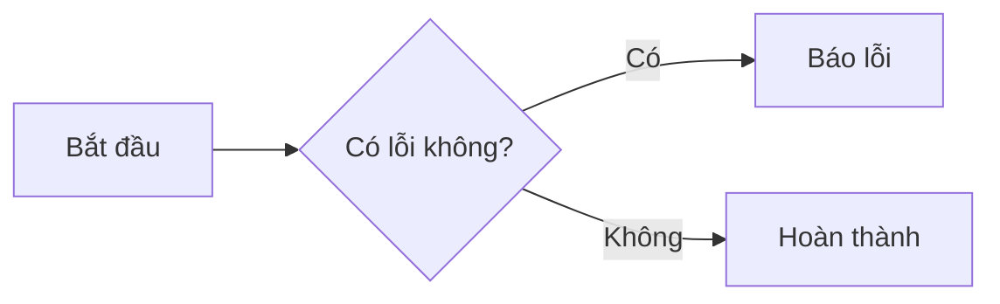

# 🚀 Cheatsheet — Claude CoWork Agent Mastery

Tài liệu này tóm tắt nhanh các câu lệnh, prompt mẫu và kỹ thuật quan trọng nhất trong suốt khóa học. Hãy lưu trữ (Bookmark) lại để tra cứu nhanh khi làm việc.

---

## Buổi 1: Nhập môn & Prompt Engineering

### Quick Reference (Thao tác nhanh)
- **Shift + Enter**: Xuống dòng trong khung chat.
- **Tải tài liệu**: Kéo thả file PDF, Text, CSV trực tiếp vào khung chat.
- **Chọn Model**: Góc trên cùng, ưu tiên dùng `Claude 3.5 Sonnet` cho tác vụ code/viết lách.

### Mẫu Prompt (Prompt Templates)
**1. Đóng vai (Role-play) + Định dạng kết quả:**
> "Bạn là một chuyên gia Marketing với 10 năm kinh nghiệm. Hãy phân tích sản phẩm [Tên SP] và đưa ra chiến lược quảng cáo. Trình bày kết quả dưới dạng bảng gồm 3 cột: Đối tượng, Thông điệp, Kênh tiếp cận."

**2. Chuỗi suy nghĩ (Chain-of-thought) để giải toán/logic:**
> "Hãy giải quyết vấn đề sau. Yêu cầu quan trọng: Hãy suy nghĩ từng bước một (step-by-step) và trình bày logic của bạn trước khi đưa ra kết quả cuối cùng."

---

## Buổi 2: Làm chủ Projects & Artifacts

### Artifacts (Tạo tác)
- **Khi nào dùng**: Cần tạo sơ đồ Mermaid, giao diện React (UI), code nguyên file, văn bản dài.
- **Tip**: Luôn yêu cầu Claude: *"Hãy tạo một Artifact cho nội dung này để tôi dễ theo dõi"*.

### Cấu trúc cơ bản của Sơ đồ Mermaid (Flowchart)


---

## Buổi 3: Xây dựng AI Agent & Skills

### Kỹ thuật tạo Custom Instructions (System Prompt)
Đặt câu lệnh này trong phần cài đặt Project:
> "Bạn là một Trợ lý Code nghiêm khắc. KHÔNG BAO GIỜ giải thích dài dòng hay chào hỏi. Chỉ in ra kết quả đoạn code đã sửa. Luôn dùng ngôn ngữ Python 3.10+."

### Mẫu viết Skill (File `.md` cho AI học)
Cấu trúc 1 file Skill chuẩn:
```markdown
# Tên Kỹ Năng: Phân tích báo cáo
**Mục đích**: Hướng dẫn AI cách trích xuất dữ liệu từ báo cáo tài chính.
**Quy trình 3 bước**:
1. Đọc nội dung file PDF được cấp.
2. Tìm kiếm doanh thu và lợi nhuận.
3. Xuất ra định dạng JSON.
```

---

## Buổi 4: Sử dụng Tools (Công cụ)

### Các Tools quan trọng của Agent
- **`view_file`**: Đọc nội dung một file cụ thể trên máy tính. (Nhanh hơn đọc toàn thư mục).
- **`list_dir`**: Xem có file gì trong một thư mục (Folder).
- **`search_web`**: Tìm kiếm thông tin cập nhật trên Internet.
- **`run_command`**: (Chỉ dành cho môi trường máy tính nội bộ) Chạy lệnh Terminal/Powershell.

**Tip:** Khi muốn AI sửa code, đừng bảo "sửa code đi", hãy bảo: *"Hãy dùng tool `view_file` đọc file X, sau đó dùng `replace_file_content` để sửa dòng 10 tới 20."*

---

## Buổi 5: Tác vụ dài & Background Tasks

### Quản lý Background Task
Khi AI chạy lệnh mất nhiều thời gian, AI sẽ đưa lệnh đó vào nền (Background).
- **`manage_task` (list)**: Xem các tiến trình đang chạy.
- **`manage_task` (kill)**: Hủy tiến trình bị treo.
- **Cron Job**: *"Hãy chạy tác vụ kiểm tra giá Bitcoin mỗi 30 phút một lần"* (AI sẽ dùng biểu thức Cron: `*/30 * * * *`).

---

## Buổi 6: Kết nối nền tảng (API & MCP)

### Cấu hình MCP Server (Filesystem) mẫu
*(Lưu ở `claude_desktop_config.json`)*
```json
{
  "mcpServers": {
    "filesystem": {
      "command": "npx",
      "args": [
        "-y",
        "@modelcontextprotocol/server-filesystem",
        "C:\\Users\\ryant\\Desktop\\Du_An_AI"
      ]
    }
  }
}
```

### Lệnh gọi API Anthropic (cơ bản)
```bash
curl https://api.anthropic.com/v1/messages \
     -H "x-api-key: YOUR_KEY" \
     -H "anthropic-version: 2023-06-01" \
     -H "content-type: application/json" \
     -d '{"model": "claude-3-5-sonnet-20241022", "messages": [{"role": "user", "content": "Hello"}]}'
```

---

## 📊 Bảng so sánh nhanh các Model Claude

| Model | Tốc độ | Trí thông minh | Phù hợp nhất cho |
|---|---|---|---|
| **Haiku** | ⚡ Rất Nhanh | Trung bình - Khá | Tóm tắt nhanh, phân loại dữ liệu, OCR |
| **Sonnet (3.5)** | 🚀 Nhanh | Rất Cao | Code, viết lách sáng tạo, agent automation |
| **Opus** | 🐢 Chậm | Cực Kỳ Cao | Giải toán phức tạp, chiến lược, phân tích sâu |

---
*Chúc bạn thành công với hành trình tự động hóa cùng Claude!*
